## Today

- Equilibrium and nonequilibrium
- Energy landscapes
- Glasses

## Equilibrium

Equilibrium means:

:::{.incremental}

- zero entropy production
- no net flows of matter or energy
- detailed balance $$\pi_i P_{i \rightarrow j} = \pi_j P_{j \rightarrow i}$$

- time reversibility
- state of maximum entropy given the constraints (we saw this in multiple instances, e.g. liquid crystals)
- macroscopic observables do not change with time (**stationarity**)
- equivalence between time and ensemble averages (**ergodicity**)
:::

## Ergodicity

Let's focus a moment on ergodicity. 

- The basic idea is that we are performing a measurement. This takes time: the **observation time** $t_{obs}$.
- If the system is **ergodic**, then the **time average** over $t_{obs}$ is equivalent to an ensemble average over **many copies** of the system at a fixed time.

$$\overline{A} = \frac{1}{t_{obs}} \int_{0}^{t_{obs}} A(t) dt = \langle A \rangle $$

- It is important that then $t_{obs}$ needs to be large enough for the system to explore a large number of representative configurations:
    - the dynamics needs to **sample** the relevant parts of phase space in order to get an **unbiased estimate** of the average.
    - the dynamics has its own **relaxation timescales** $\tau$ that need to be considered.

- Ergodicity is typically assumed, but it is a strong assumption.

## Equilibration and relaxation

- Typically, a system requires time in order to **reach equilibrium**:
    - a system is **prepared** in some state at time $t_0$,
    - it is the **put in contact** with an environment that we assume to be thermal (fundamentally, a large system of which we know very little, for which we express our maximal ignorance by only tracking its temperature, pressure etc...)
    - then we **let it evolve** until it reaches equilibrium at time $t_{eq}$.
    - This **equilibration time depends**:
        - on the distance from equilibrium between the initial and final state
        - on the **intrinsic dynamics** of the system (its own relaxation time)

## What could go wrong?

On the chalkboard, let's list some issues that could arise during equilibration.

## What could go wrong?

::: {.absolute-box .rot1 .color1 style="left:10%; top:20%;"}
**Phase space hard to explore**  
System gets **stuck**: the dynamics explores a local equilibrium region
:::

::: {.absolute-box .rot2 .color2 style="left:55%; top:25%;"}
**Very slow evolution**  
The system keeps changing, it **ages**
:::

::: {.absolute-box .rot4 .color3 style="left:8%; top:60%;"}
**Internal/external driving**  
Currents are generated and the system never equilibrates
:::

::: {.absolute-box .rot3 .color4 style="left:52%; top:57%;"}
**Constrained dynamics**  
Some configurations are forbidden (constraints on the rules of motion) and non-ergodicity arises
:::

## Energy landscapes

- A system of many particles has many degrees of freedom.
- The potential energy $U(x_1, x_2, \ldots, x_N)$ is a **scalar function** of all these degrees of freedom.
- We can think of it as the altitude of a **landscape** in a high-dimensional space.
- Grouping similar configurations into states gives a **free energy landscape** $F=-k_BT\ln P$: low free energy = high probability.
    - it depends on the **intensive parameters** (temperature, pressure, etc..)

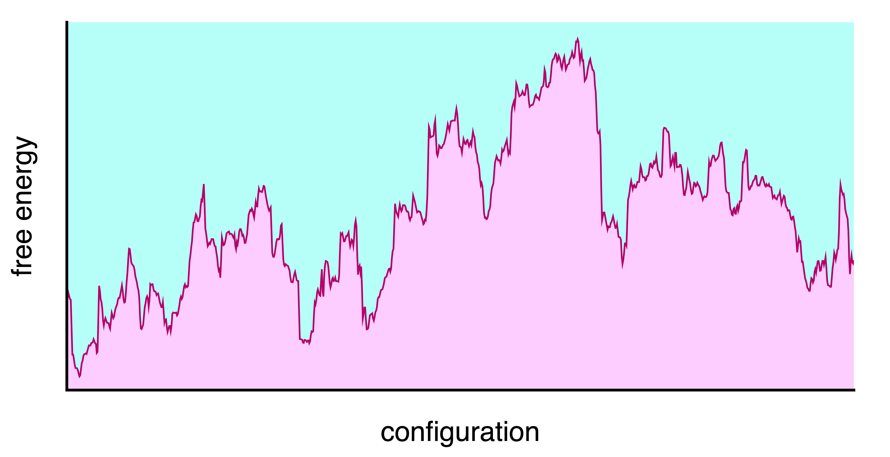

## Energy landscapes

- Different minima correspond to different conformations or **states** of the system. (e.g. liquid/gas, crystal/amorphous solid, folded/unfolded protein)
- They are separated by **energy barriers** $\Delta F$
- The time to transition is often modelled as Arrhenius $\tau \sim \exp\left(\dfrac{\Delta F}{k_{B} T}\right)$

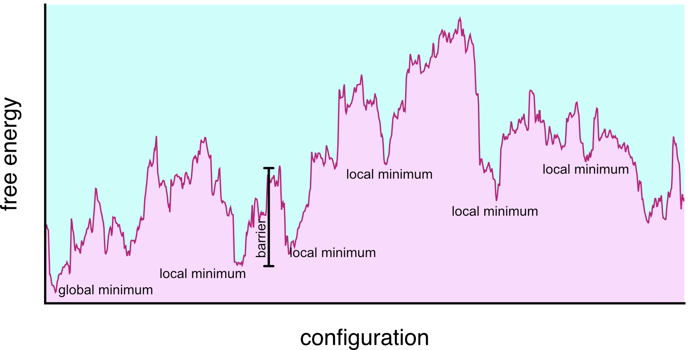

## Metabasins

When the temperature allows it, connected minima can be grouped into single **basins** called **metabasins**.

- they are not just energy minima, they include entropy
- they can behave as bona fide local **equilibria**
- These are akin to the **metastable states**.

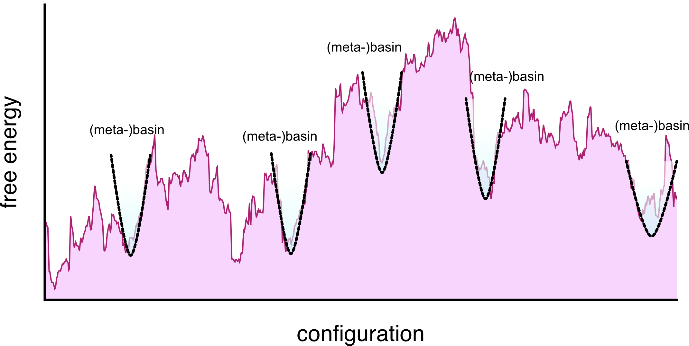

## Configurational entropy

- The number of distinct metabasins can be very large.
- We can define a **configurational entropy** $S_{conf}$ that counts the number of distinct minima:
$$S_{conf} = k_{B} \ln N_{\mathrm minima}$$

**Different** from the total entropy $S$ 
$$
S(V) = S(V_0) + \int_{V_0}^{V} \left( \frac{\partial P}{\partial T} \right)_{V'} dV' \quad (\text{at fixed } T)
$$

or (at constant volume)

$$
S(T) = S(T_0) + \int_{T_0}^{T} \frac{C_V(T')}{T'} dT'
$$
where $C_V$ is the heat capacity at constant volume and $T_0$ is a reference temperature.

For gas, fluids, and liquids at high T only the **total entropy** is well defined.

## Glasses

Glassy systems are a broad class of systems, not necessarily atomic or molecular, that exhibit **arrested dynamics**

- upon changing a thermodynamic parameter (e.g. temperature, density) the system's relaxation time $\tau$ increases dramatically
- the system falls out of equilibrium and becomes **non-ergodic**
- the system behaves as a solid, but lacks long-range order (it is **amorphous**)

| Glassformer         | Scale of Constituents      | Properties                                      |
|---------------------|---------------------------|-------------------------------------------------|
| Silicate glass      | Atomic (Si, O atoms)      | Hard, transparent, high melting point           |
| Metallic glass      | Atomic (metal atoms)      | High strength, elastic, corrosion resistant     |
| Polymer glass       | Macromolecular (polymers) | Flexible, low density, tunable glass transition |
| Colloidal glass     | Mesoscopic (colloids, ~nm–μm) | Opaque, tunable rheology, soft solid-like   |
| Molecular glass     | Molecular (organic molecules) | Low melting point, fragile, optical uses   |
| Sugar glass         | Molecular (sucrose, glucose)  | Brittle, water soluble, low thermal stability   |
| Chalcogenide glass  | Atomic (S, Se, Te atoms)  | Infrared transparency, phase-change memory      |

## Glassy systems

But glassy physics is broader than glassy materials: dense assemblies in general will display glassy dynamics.

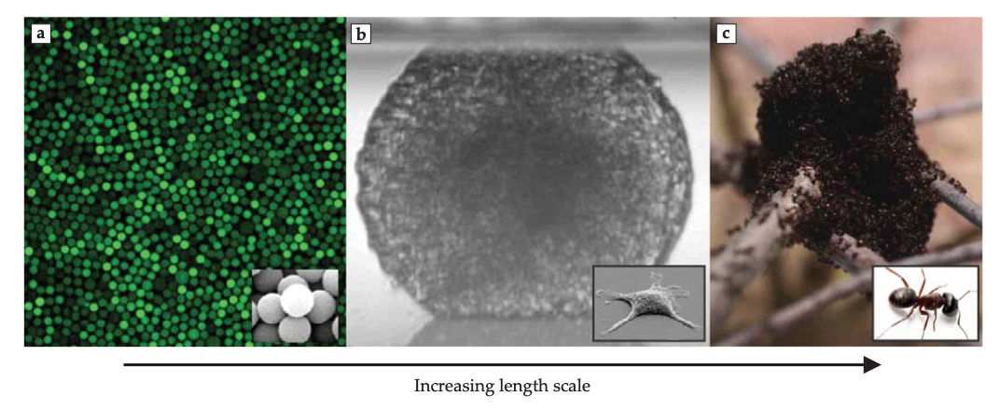 

## Glass formation

:::{.columns}
::: {.column width="30%"}
To form a glass we:

- start from the liquid at high temperature
- cool with a finite cooling rate fast enough to **avoid crystallisation**
- enter a local equilibrium state (the **supercooled liquid**)
- at some point the relaxation time $\tau$ becomes longer than the experimental time scale and the system **falls out of equilibrium** into a glassy state
- changing the cooling rate changes the glass transition temperature $T_g$ and the final glass properties
:::
::: {.column width="70%"}
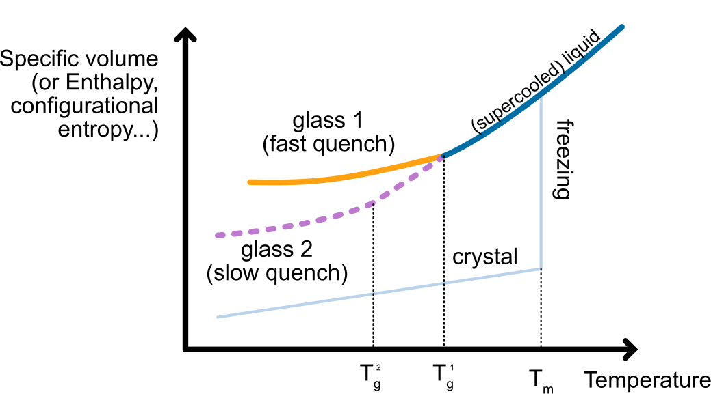
:::
:::

## Macroscopic Glass properties

- Glasses are **solids**: they have a finite shear modulus and yield stress
- Glasses are **amorphous**: they lack long-range order (no Bragg peaks in scattering experiments)
- Glasses are **history-dependent**: their properties depend on the cooling rate and thermal history
- Glasses exhibit **ageing**: their properties slowly evolve with time as they explore deeper minima in the energy landscape

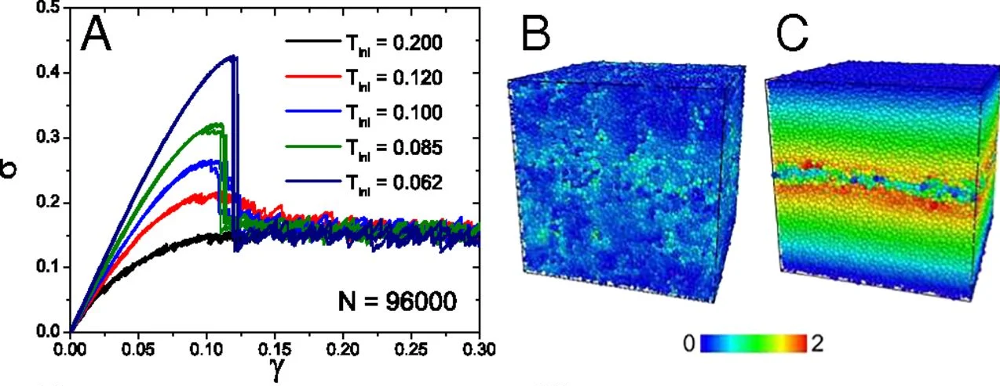

## Slowing down

:::{.columns}
::: {.column width="50%"}
Their solid-like behavior arises from the dramatic slowing down of their dynamics as they approach the glass transition.

We quantify this with density autocorrelation functions such as the self-intermediate scattering function:
$$F_s(q, t) = \frac{1}{N} \left\langle \sum_{j=1}^{N} e^{i \mathbf{q} \cdot [\mathbf{r}_j(t) - \mathbf{r}_j(0)]} \right\rangle$$

It decays in two steps:

- a fast decay corresponding to **vibrations** within the cage formed by neighbouring particles, occurring on a timescale called the **beta relaxation time** $\tau_{\beta}$
- a slow decay corresponding to **structural relaxation** as particles escape their cages, taking place on the much longer **alpha relaxation time** $\tau_{\alpha}$
:::
::: {.column width="50%"}
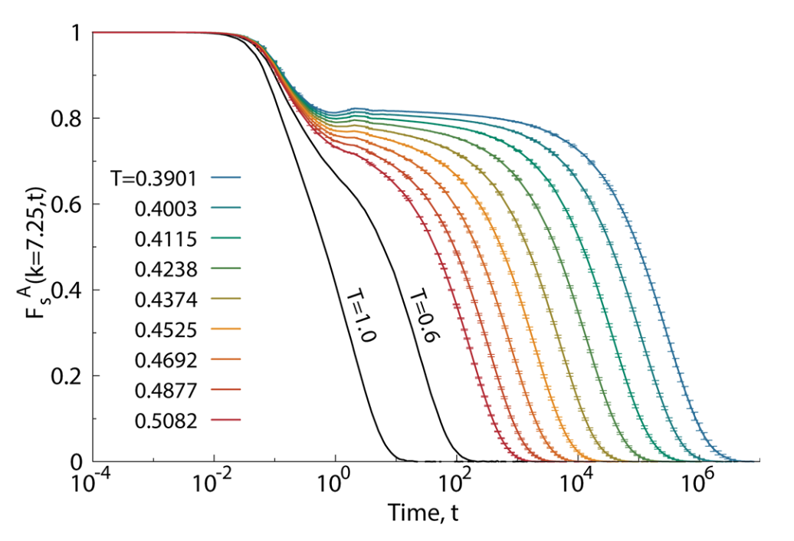
:::
:::

## Divergence of relaxation time and viscosity

:::{.columns}
::: {.column width="50%"}
The alpha relaxation time $\tau_{\alpha}$ is proportional to the viscosity $\eta$ and both increase dramatically as the temperature approaches the glass transition temperature $T_g$.

Phenomenologically one distinguishes between:

- **Strong glassformers**: Arrhenius behaviour of $\tau_{\alpha}$ and $\eta$ $\sim \exp\left(\dfrac{E_a}{k_{B} T}\right)$
- **Fragile glassformers**: super-Arrhenius behaviour $\tau_{\alpha}$ and $\eta$. Often modelled with the **Vogel-Fulcher-Tammann** (VFT) equation $\tau \sim \exp\left(\dfrac{A}{T - T_0}\right)$ where $T_0$ corresponds to a **divergence** at **finite** temperature $\to$ **phase transition?**
:::
::: {.column width="50%"}
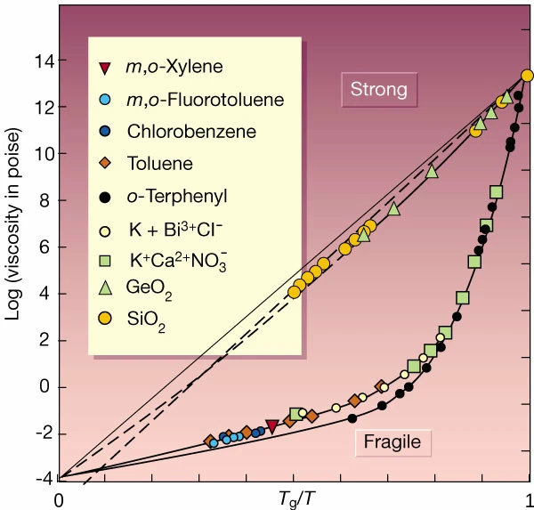
:::
:::

## Cages and cooperativity

The two-step decay of $F_s(q,t)$ has a simple microscopic picture.

- At low $T$ each particle is trapped in a **cage** formed by its neighbours: it rattles inside it ($\tau_\beta$, picoseconds, almost independent of $T$) and only rarely escapes ($\tau_\alpha$, growing by many orders of magnitude).
- This **separation of timescales**, $\tau_\alpha\gg\tau_\beta$, means that at any instant almost all particles are caged and only a few are moving.
- To escape, a particle needs its neighbours to make room, but they are caged too: relaxation must be **cooperative**.

Every theory of the glass transition has to say how large the cooperative regions are, and what sets the time to rearrange them.

## Explaining the glass transition

- The glass transition is still not fully understood. 
- It is one of the major open problems in condensed matter physics.

We have however various theories, mainly in two broad classes:

- **Thermodynamic theories**: posit an underlying phase transition at a temperature $T_K$ (Kauzmann temperature) where the configurational entropy vanishes.
- **Dynamic theories**: attribute the slowing down to kinetic effects without invoking an underlying thermodynamic transition. 

## Configurational entropy and the Kauzmann paradox
:::{.columns}
::: {.column width="50%"}
As we take liquids to low temperatures, we can separate the total entropy into a vibrational and configurational part and define
$$ S_{conf}(T) = S(T) -S_{vib}(T)$$

For several fluids, this *decreases* as the temperature is lowered, in an intriguing way. It is estimated from the entropy difference between liquid and crystal (similar vibrational entropies).

> […] Perhaps in some instances a thermodynamic **“freezing-in”** of degrees of freedom does take place as a desperate result of the liquid’s excessive generosity with its limited supply of entropy and energy as its temperature is lowered below the melting point. This would imply the existence of **some kind of state of high order** for the liquid at low temperature which **differs** from the normal crystalline state. A plausible structure for such a state seems, however, difficult to conceive, and we believe that the paradox is better resolved in another way […] (W. Kauzmann, Chem. Rev. 43, 219 (1948)).

:::
::: {.column width="50%"}

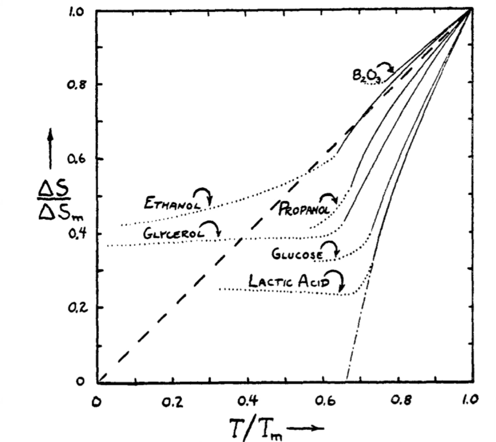
:::
:::

## A thermodynamic theory: the Adam-Gibbs scenario

The **Adam-Gibbs model** links the dramatic slowdown of dynamics to the underlying thermodynamics through **configurational entropy** $S_{\rm conf}$.

- The key idea is the existence of **cooperatively rearranging regions** (CRRs): to relax, particles need to move together and explore a new metabasin in the energy landscape.
- At low $T$ a particle cannot move alone: a CRR is the smallest region that can rearrange without changes outside it. Larger regions have higher barriers, so the smallest ones dominate.
- To rearrange, a region needs at least two configurations, $W^*=2$: $s^*=k_B\ln 2$ is the **bare minimum** entropy for relaxation, the same at every $T$ and for every size.
- Cooling reduces the configurations available to any given region, so the minimal region that still reaches $s^*$ must grow: the threshold is fixed, the size is not.

## Adam-Gibbs: size of the CRRs

:::{.columns}
::: {.column width="60%"}
- We **assume** that the configurational entropy is extensive: a region of $n$ particles has $n\,s_{\rm conf}$, with $s_{\rm conf}=S_{\rm conf}/N$ the bulk value per particle.
- It can rearrange once $n\,s_{\rm conf}\ge s^*$, so the smallest CRR has
$$n_{CRR}=\frac{s^*}{s_{\rm conf}}$$
particles: as $s_{\rm conf}$ drops, CRRs grow.
- The system is a mosaic of $M_{CRR}=N/n_{CRR}$ independent CRRs and, by the same extensivity, $S_{\rm conf}=M_{CRR}\,s^*$.
- A metabasin of the whole system is one choice of configuration for every CRR; rearranging one CRR moves the system to a neighbouring metabasin.
:::
::: {.column width="40%"}
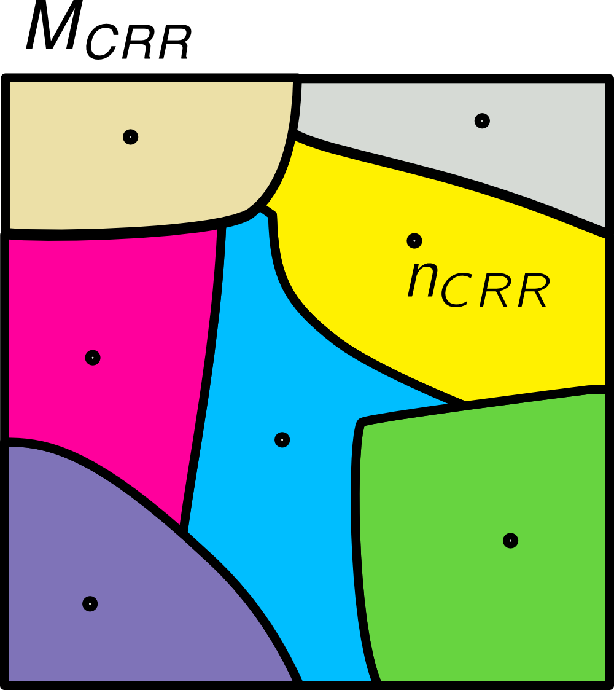
:::
:::

## A thermodynamic theory: the Adam-Gibbs scenario

Assume **activated dynamics**, with a barrier $\Delta\mu$ per particle. A CRR must then cross

$$
\Delta E = n_{CRR}\,\Delta\mu=\frac{s^*\Delta\mu}{s_{\rm conf}}
$$

using $n_{CRR}=s^*/s_{\rm conf}$ from the previous slide.

With the Arrhenius law

$$
\tau_\alpha=\tau_0\,e^{\Delta E/k_BT}
$$

this gives the **Adam-Gibbs relation**

$$
\tau_\alpha(T) = \tau_0 \exp\left(\frac{A}{T s_{\rm conf}(T)}\right), \qquad A=\frac{s^*\Delta\mu}{k_B}
$$

As temperature decreases, $s_{\rm conf}$ drops and $\tau_\alpha$ grows rapidly.

## From Adam-Gibbs to VFT

How does $s_{\rm conf}$ vanish? Kauzmann's extrapolation: it decreases **smoothly** and reaches zero at $T_K$. Close to its zero, a smooth function is **linear**:
$$
s_{\rm conf}(T)\simeq K\,\frac{T-T_K}{T_K}\qquad (K>0)
$$

Then $T s_{\rm conf}=K\dfrac{T}{T_K}(T-T_K)$ and, exactly,
$$
\frac{A}{T s_{\rm conf}}=\frac{B}{T-T_K}-\frac{B}{T},\qquad B=\frac{A}{K}
$$

The second term stays finite at $T_K$: it changes much more slowly than the divergent one, so we absorb it in $\tau_0$:
$$
\tau_\alpha(T) \simeq \tau_0'\exp\left(\frac{B}{T - T_K}\right)
$$

This is the **VFT** form with $T_0=T_K$ (corrections to linearity only rescale $\tau_0$): a testable link between kinetics ($T_0$) and calorimetry ($T_K$). They agree closely in many fragile liquids (Richert & Angell, J. Chem. Phys. 108, 9016 (1998)).

It also points to a **critical divergence**: as $s_{\rm conf}\to0$ at $T_K$, the CRR size $n_{CRR}\propto 1/s_{\rm conf}$ diverges.

- Evidence for decreasing configurational entropy, but debated existence of a true thermodynamic transition.

## A dynamic theory: dynamical facilitation

:::{.columns}
::: {.column width="70%"}
Start again from the **cages**. Thanks to the separation of timescales we can coarse-grain space and time into regions that are **mobile** (a cage has just broken) or **immobile** (still caged).

- At low $T$ mobile regions are rare, localised **excitations**, with concentration $c\simeq e^{-J/k_BT}$ ($J$: energy to create one). Their thermodynamics is trivial: no transition.
- **Postulate** (kinetic constraint): an immobile region can relax only if a neighbouring region is mobile. Mobility **facilitates** mobility.

Mobile and immobile regions coexist: glassy dynamics is **heterogeneous** in space and time. This **dynamical coexistence** can be formalised as a dynamical phase transition.
:::
::: {.column width="30%"}
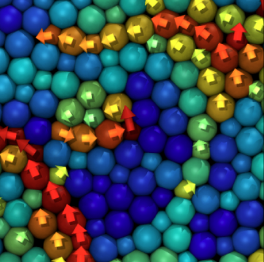
- Recent evidence suggests facilitation as a dominating mechanism for relaxation at low temperatures.

:::
:::

## Dynamical facilitation: hierarchical relaxation

- Excitations are typically a distance $\ell\sim c^{-1/d_f}=e^{J/(d_f k_BT)}$ apart ($d_f$: their fractal dimension).
- To relax a region, mobility has to be brought over a distance $\ell$ through a chain of facilitated moves. Because of the constraint, the chain is **hierarchical**, and its energy barrier grows only logarithmically with distance (e.g. the East model):
$$
\Delta E(\ell)\simeq\gamma\,J\ln\ell
$$
- With Arrhenius,
$$
\ln\tau_\alpha\simeq\frac{\Delta E(\ell)}{k_BT}\simeq\frac{\gamma}{d_f}\left(\frac{J}{k_BT}\right)^2
$$
- Facilitated dynamics sets in below an **onset** temperature $T_o$; measuring from there gives the **parabolic law**
$$
\ln\frac{\tau_\alpha}{\tau_o}\simeq \frac{\gamma}{d_f}\,\frac{J^2}{k_B^2}\left(\frac{1}{T}-\frac{1}{T_o}\right)^2
$$

Super-Arrhenius, because excitations get sparser on cooling and the barrier grows, but finite at every $T>0$: **no divergence**, no criticality.

## Demonstration of facilitated dynamics and dynamical heterogeneities

Time evolution of the magnitude of the displacement field in a model of glass governed by dynamical facilitation from Hasyim and Mandadapu PNAS (2024):

:::{.columns}
::: {.column width="25%"}
:::
:::{.column width="60%"}

:::
:::{.column width="15%"}

:::
:::
Excitations emerge and trigger further mobility in their vicinity, leading to a cascade of relaxation events.

## Can the data decide?

:::{.columns}
::: {.column width="60%"}
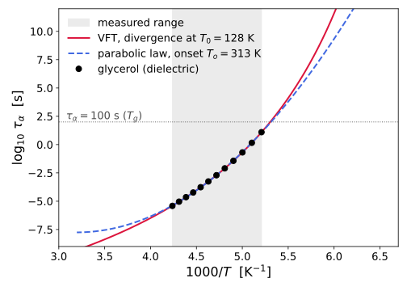
:::
::: {.column width="40%"}
Fitting the same relaxation times of glycerol with both laws:

- both fit within $0.02$ decades over the measured range
- VFT diverges at $T_0=128$ K, the parabolic law has an onset at $T_o=313$ K and never diverges
- they only part ways below $T_g$, where we cannot equilibrate

Relaxation times alone cannot decide (Hecksher et al. Nat. Phys. 2008). Tests must come from other predictions, such as $T_0$ vs $T_K$, growing static lengths, excitations and dynamical heterogeneity, or from reaching lower temperatures (ultrastable glasses, swap Monte Carlo).
:::
:::

## Unification

:::{.columns}
::: {.column width="50%"}
- Much more to glassy dynamics: 
    - geometrical frustration
    - local structures
    - growth of lengthscales
    - jamming
    - mean field solutions (see Nobel Prize Giorgio Parisi)

Ongoing work to unify the various scenarios.

- Example: Turci et al PRX (2017): a numerical demonstration that an extension dynamical facilitation is compatible with decreasing entropies, emergence of local structures and criticality.
:::
::: {.column width="50%"}
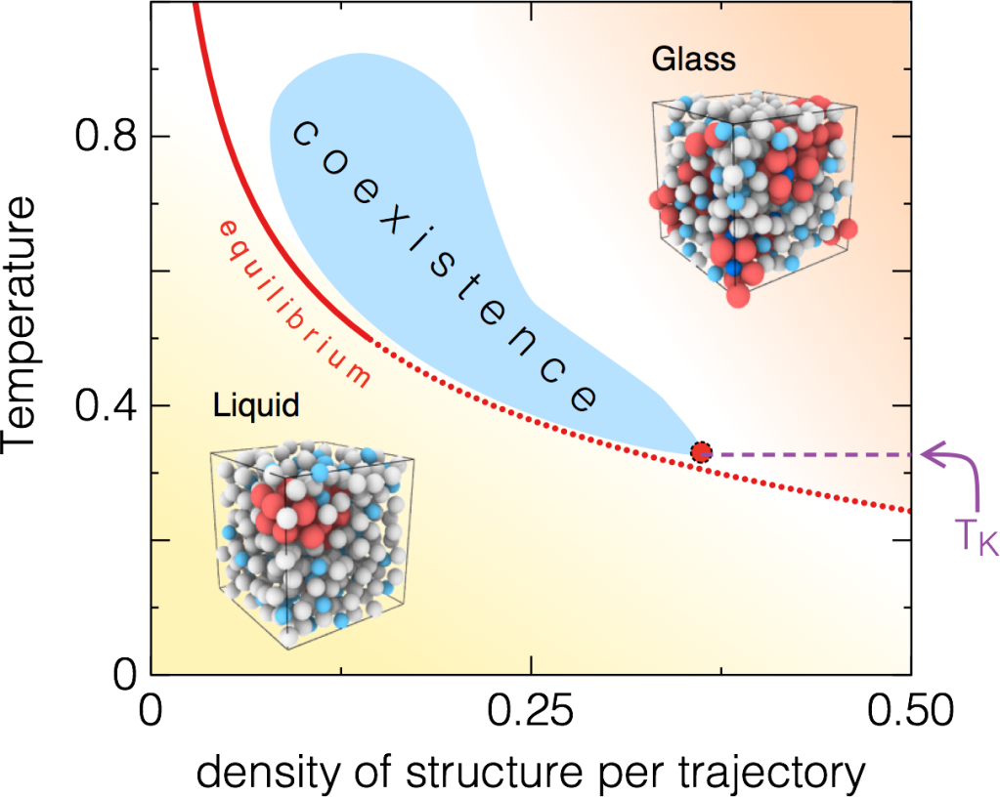
:::
:::

## Summary: glasses {.smaller .scrollable}

| Topic | Key result |
|---|---|
| Energy landscape | $F=-k_BT\ln P$ of coarse-grained states; minima grouped into metabasins |
| Configurational entropy | $S=S_{\rm conf}+S_{\rm vib}$, $S_{\rm conf}=k_B\ln N_{\rm minima}$ |
| Glass formation | avoid crystallisation; $T_g$ where $\tau_\alpha>t_{\rm obs}$: ergodicity lost, protocol dependent |
| Relaxation | two-step $F_s(q,t)$: $\beta$ (cage), $\alpha$ (structural); $\tau_\alpha\propto\eta$ |
| Strong vs fragile | Arrhenius vs VFT $\eta\propto e^{B/(T-T_0)}$ |
| Theories | Adam-Gibbs $\tau_\alpha=\tau_0\,e^{A/Ts_{\rm conf}}$ (thermodynamic) vs dynamical facilitation (no finite-$T$ divergence) |

[Full summary with links in the notes](https://fturci.github.io/course-disordered-matter/soft-matter/soft-matter_glasses.html#summary){target="_blank"}
