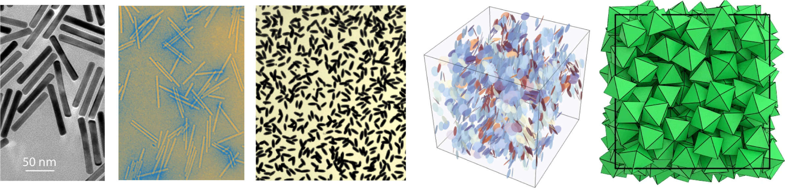
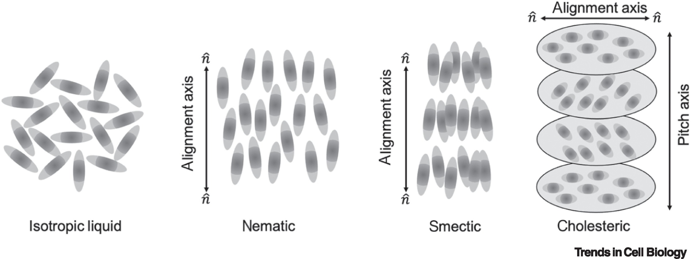
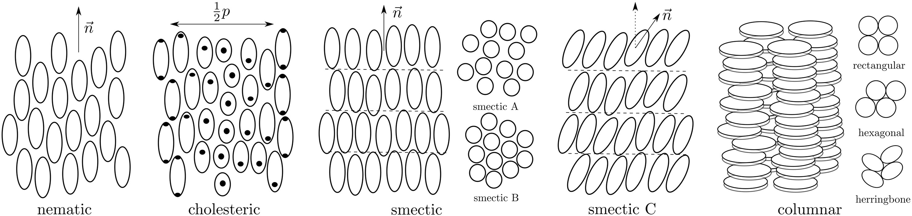
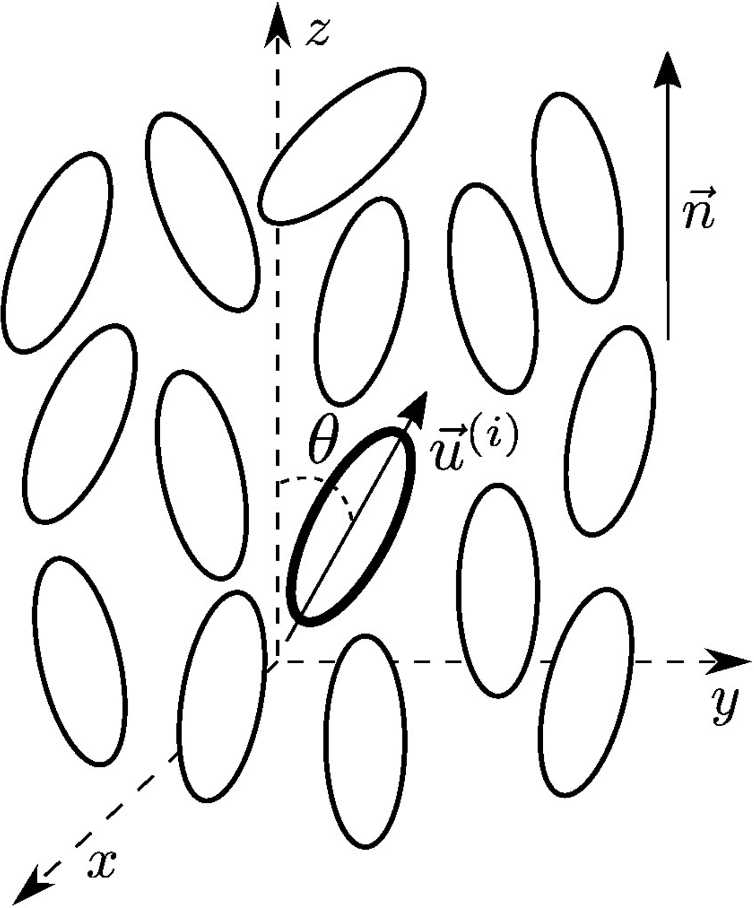
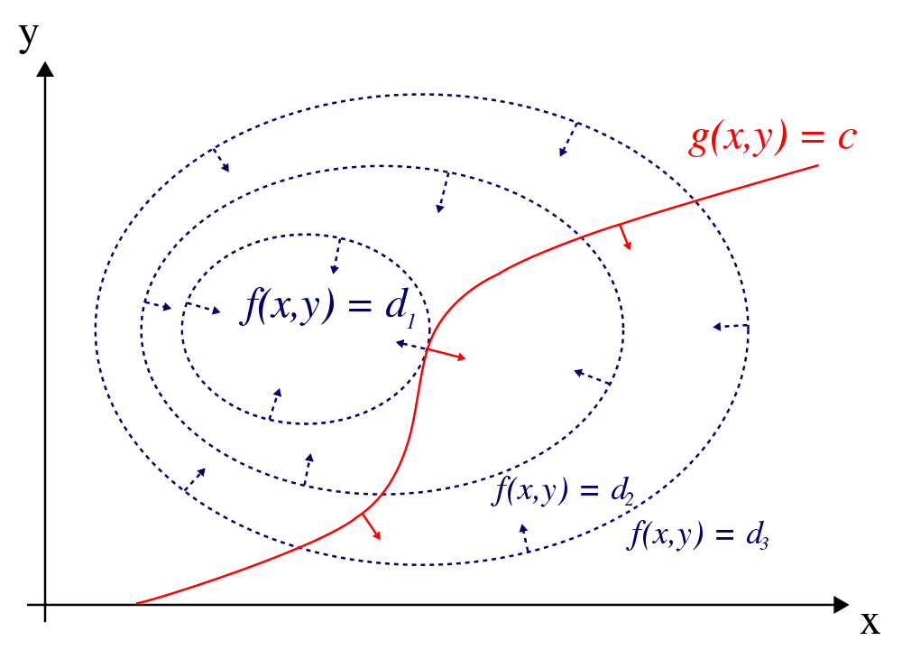

## What are Liquid Crystals?


- Intermediate phases between **liquids** and **crystals**
- Exhibit **orientational order** without full positional order
- Formed by **anisotropic particles** (rods, ellipsoids, plates)
- Key property: **decoupling** of orientational and translational degrees of freedom


## Types of Order

**Positional order**: Regular arrangement of particle positions (lattice)

**Orientational order**: Angular alignment of particles

| Phase | Positional | Orientational |
|-------|-----------|---------------|
| Crystal | Yes (3D) | Yes |
| Liquid | No | No |
| **Liquid Crystal** | **Partial/No** | **Yes** |

The strength of the ordering is determined by the **decay** of correlation functions:

- in liquids we have at best short range order (exponential decay of the oscillations in the $g(r)$)
- in crystals we have long-range order — correlations do not decay (sharp Bragg peaks in $S(\mathbf{k})$ and $g(r)$); this order is only disrupted by defects (dislocations, grain boundaries) on macroscopic scales

## Anisotropic Particles

Many natural and artificial systems have anisotropy




## Liquid Crystal Phases

:::{.columns}
:::{.column}
- **Isotropic fluid**: No long-range order (like normal liquids)
- **Nematic phase**: Orientational order, no positional order. 
- Particles align along a common direction: the **director** $\mathbf{n}$
- **Smectic phase**: Layered structure with orientational order
    - Positional order in 1D (layers)
  - Liquid-like within layers
:::
:::{.column}
- **Columnar phase**: Particles stack into columns
  - 2D positional order
- **Crystal**: Full 3D positional + orientational order
- **Chiral nematic (Cholesteric)**: Director forms a helix
:::
:::




---

## Phase Comparison

| Phase | Positional Order | Orientational Order |
|-------|-----------------|---------------------|
| Isotropic | No | No |
| Nematic | No | Yes (long-range) |
| Smectic | Yes (1D: layered) | Yes |
| Columnar | Yes (2D: columns) | Yes |
| Cholesteric | No | Yes (helical) |
| Crystal | Yes (3D: lattice) | Yes |




## Phase Comparison: Textures and Defects

![Examples of phases/textures: (a)  Nematic with surface point defects. (b) Thin nematic film on isotropic substrate. (c) Thread-like nematic texture. (d) Cholesteric fingerprint (helical axis in plane). (e) Short‑pitch cholesteric (standing helix) with vivid colors. (f) Long-range cholesteric DNA alignment in a magnetic field. (g, h) Focal conic textures of chiral smectic A. (i) Focal conic texture of chiral smectic C. (j) Hexagonal columnar spherulitic texture. (k) Rectangular discotic phase. (l) Hexagonal columnar phase. From Andrienko, Journal of Molecular Liquids (2018)](./figs/examplesLx.jpg)

## Orientation and director

:::{.columns}
:::{.column width=60%}
- Orientation of a rigid rod is described by a **unit vector** $\mathbf{u}$ along its long axis

- The particles are head-tail symmetric, so they have a centre of symmetry

- Because $\mathbf{u}$ and  $-\mathbf{u}$ are equiprobable, on average $$\langle \mathbf{u}\rangle=0$$

- Vectorial order parameter is zero. The next non-trivial invariant is a **second rank tensor**

<div style="font-size:0.75em">
| Tensor | Rank | Example order parameter |
|--------|------|-------------------------|
| Scalar | 0 | Scalar nematic S (degree of alignment), e.g., S = ⟨P2(cos θ)⟩ |
| Vector | 1 | Polarization or magnetization vector P / M (polar order) |
| Second‑rank tensor | 2 | Matrices, Alignment tensor $Q_{ij}$ (nematic order) |
| Third‑rank tensor | 3 | Octupolar / tetrahedral order $T_{ijk}$ |
</div>

:::
:::{.column width=40%}

:::
:::

## The Nematic Order Parameter

For **head-tail symmetric** rods, we cannot simply average orientations.

Instead, construct the **alignment tensor** 

$$
\mathbf{Q}=\dfrac{d}{d-1}\left\langle\mathbf{u}_i \otimes \mathbf{u}_i-\dfrac{1}{d}\mathbf{I}\right\rangle
$$

- we make it **traceless** by removing the identity
- we make it include quadratic combinations (it is as **second moment**, essentially the covariances)
- $\otimes$ is the outer product, giving a $d\times d$ matrix:
$$
\mathbf{u} \otimes \mathbf{u} =
\begin{pmatrix}
u_1 u_1 & u_1 u_2 & \cdots & u_1 u_d \\
u_2 u_1 & u_2 u_2 & \cdots & u_2 u_d \\
\vdots  & \vdots  & \ddots & \vdots  \\
u_d u_1 & u_d u_2 & \cdots & u_d u_d
\end{pmatrix}
$$

where $d$ is dimensionality, $\mathbf{u}_i$ is the unit orientation vector. For us, $d=2,3$

---

## Extracting Order

- Diagonalisation: it extracts the invariants (the properties that do not change wrt a coordinate change or rotations)


- **Largest eigenvalue** $\rightarrow$ scalar order parameter $\mathcal{S}$
- **Corresponding eigenvector** $\rightarrow$ director $\mathbf{n}$

$$
\mathcal{S} \in [0, 1]
$$

- $\mathcal{S} = 0$: isotropic (random orientations)
- $\mathcal{S} = 1$: perfect nematic order (all aligned)

:::{.callout-caution}
The nematic order parameter $\mathcal{S}$ should not be confused with the entropy $S$.
:::
---

## 2D Nematic Order Parameter

In two dimensions, the director is simply characterised by the angle $\psi$  expressed as 
$$
\psi = \frac{1}{2} \operatorname{atan2}(\sin{2\theta_i}, \cos{2\theta_i}).
$$
and the nematic order parameter is simply

$$
\mathcal{S}=\sqrt{\left\langle\cos 2 \theta_i\right\rangle^2+\left\langle\sin 2 \theta_i\right\rangle^2}
$$


## 3D Nematic Order Parameter

In 3D, choosing coordinates along director $\mathbf{n}$:

$$
\mathcal{S}=\dfrac{1}{2} \left\langle 3\cos ^2 \theta_i-1\right\rangle
$$

where $\theta_i$ is angle between particle $i$ and director.

This uses the **Legendre polynomial** $P_2(\cos\theta)$ to enforce head-tail symmetry.

- Lowest nontrivial rotationally‑invariant scalar that is even under $\mathbf{n}\to -\mathbf{n}$


| n | Legendre polynomial $P_n(x)$ | Head-tail symmetric? |
|---:|---------------------------|:---------------------:|
| 0 | $P_0(x)=1$ | Yes (even: $P_0(-x)=P_0(x)$) |
| 1 | $P_1(x)=x$ | No (odd: $P_1(-x)=-P_1(x)$) |
| 2 | $P_2(x)=\dfrac{1}{2}(3x^2-1)$ | Yes (even: $P_2(-x)=P_2(x)$) |
| 3 | $P_3(x)=\dfrac{1}{2}(5x^3-3x)$ | No (odd: $P_3(-x)=-P_3(x)$) |
| 4 | $P_4(x)=\dfrac{1}{8}(35x^4-30x^2+3)$ | Yes (even: $P_4(-x)=P_4(x)$) |


## Landau-de Gennes mean field theory

Using the tensorial order parameter one can express a Landau theory of the isotropic-to-nematic transition (the simplest form of orientational order appearing in liquid crystals).


For historical reasons, in 3D the alignment tensor of a uniaxial nematic is usually written as (equivalent to our definition up to a multiplicative factor)

$$
\mathbf{Q}=\mathcal{S}\left(\mathbf{n} \otimes \mathbf{n}-\frac{1}{3} \mathbf{I}\right)
$$

If we choose $z$ to be the axis along the director $\mathbf{n}$ then explicitly


$$
\mathbf{Q}=\mathcal{S}\left(\begin{array}{ccc}
-\frac{1}{3} & 0 & 0 \\
0 & -\frac{1}{3} & 0 \\
0 & 0 & \frac{2}{3}
\end{array}\right)
$$


## Orientational distribution and order parameter

We want to characterise the deviations from the director's orientation.

We can think of compiling a **probability distribution** $p(\Omega)$ of finding a rod with pair of polar angles $\Omega=(\theta,\phi)$ in a coordinates system with polar axis along $\mathbf{n}$.

- Note: the nematic phase has **cylindrical symmetry** around $\mathbf{n}$
- Hence, we have no dependency in the azimuthal angle $\phi$ but only on $\theta$.

So, by definition of an average, the orientational order parameter reads

$$\begin{align}\mathcal{S}&=\dfrac{3}{2}\left\langle(\mathbf{u} \cdot \mathbf{n})^2-\frac{1}{3}\right\rangle = \dfrac{1}{2}\langle 3 \cos^2\theta-1\rangle=\langle P_2(\cos\theta)\rangle\\
&=\int_0^{\pi}P_2(\cos\theta)p(\theta)\sin\theta d\theta
\end{align}$$
where we used the Jacobian in spherical coordinates and normalised $p(\theta)$ as $\int_0^\pi p(\theta)\sin\theta d\theta=1$.


## Landau-de Gennes mean field theory

The phenomenological Landau-de Gennes approach is to construct a **generic free energy density** as an expansion in scalar combinations of the tensor $\mathbf{Q}$ (of which $\mathcal{S}$ is an example)

$$
f=f_0+\frac{A}{2} Q_{i j} Q_{j i}-\frac{B}{3} Q_{i j} Q_{j k} Q_{k i}+\frac{C}{4}\left(Q_{i j} Q_{i j}\right)^2
$$
or in more compact form

$$
f=f_0+\frac{A}{2} \operatorname{tr} \mathbf{Q}^2-\frac{B}{3} \operatorname{tr} \mathbf{Q}^3+\frac{C}{4}\left(\operatorname{tr} \mathbf{Q}^2\right)^2
$$

- Notice that all the indices are contracted!
- $A, B, C$ are phenomenological constants (and cannot be immediately linked to microscopic properties of the anisotropic particles)

## Landau-de Gennes mean field theory

According to our earlier 3D definitions

$$
\operatorname{Tr}\left(\mathbf{Q}^2\right)=\frac{2}{3} S^2 \quad,\quad
\operatorname{Tr}\left(\mathbf{Q}^3\right)=\frac{2}{9} S^3
$$

So 
$$
f=f_0+\frac{A}{2} \operatorname{tr} \mathbf{Q}^2-\frac{B}{3} \operatorname{tr} \mathbf{Q}^3+\frac{C}{4}\left(\operatorname{tr} \mathbf{Q}^2\right)^2
$$
becomes
$$
f=f_0+\frac{A}{3}S^2-\frac{2B}{27}S^3+\frac{C}{9}S^4
$$

## Landau-de Gennes theory result

- We can use the Landau phase transition approach. 
- We can **expand** $A,B,C$ around a reference temperature $T^\ast$ :

    - $A(T)=a\left(T-T_*\right)+\cdots$
    - $B(T)= b+\dots$
    - $C(T)=c+\dots$, with $a,b,c>0$ to preserve the most relevant terms.

and obtain

$$
f-f_0=\frac{a}{3}\left(T-T^{\ast}\right) S^2-\frac{2 b}{27} S^3+\frac{c}{9} S^4 .
$$

The cubic term implies that there is a **temperature range** where **two minima coexist**:

- $S_1=0$: isotropic
- $S_2>0$: nematic

First order phase transition. The cubic terms prevents the free energy from having an inflection at $S=0$ (the free energy never gets truly flat)


## Landau-de Gennes theory result


:::{.columns}
:::{.column  width=60%}
```{pyodide}
#| echo: false
#| autorun: true
import numpy as np
import matplotlib.pyplot as plt
def plot(S,F):
    # Plot
    plt.figure(figsize=(6, 3))
    plt.plot(S, f, 'b-', linewidth=2)
    plt.axhline(y=0, color='k', linestyle='--', alpha=0.3)
    plt.xlabel('Order parameter S', fontsize=12)
    plt.ylabel('Free energy density $f - f_0$', fontsize=12)
    plt.grid(True, alpha=0.3)
    plt.tight_layout()
    plt.show()

```
```{pyodide}
T = 1.01  # working temperature
Tni = 1.0 #transition temperature
a = 1.0
b = 5.0
c = 3.0
T_star = Tni-b**2/(27*a*c)
# Order parameter range
S = np.linspace(0, 1, 200)
# Free energy density (setting f_0 = 0)
f = (a/3) * (T - T_star) * S**2 - (2*b/27) * S**3 + (c/9) * S**4
plot(S,f)
```
:::
:::{.column width=40%}
The transition temperature is 

$$
T_{N I}=T^{\ast}+\frac{b^2}{27 a c}
$$
 
while $T^{\ast}$ is a material dependent temperature, identifying instability (spinodal).

:::
:::


## Aside : constrained optimisation with Lagrange multipliers

Many physics problems can be cast in terms of constrained optimisation

| Area | Problem | Constraint |
|------|---------|-----------|
| **Mechanics** | Minimize potential energy of a pendulum | Fixed length of the string |
| **Thermodynamics** | Maximize entropy $S$ | Fixed total energy $E$ |
| **Statistical Mechanics** | Maximize Gibbs entropy $-\sum_i p_i\ln p_i$ | Normalisation $\sum_i p_i=1$, fixed $\langle E\rangle$ |
| **Liquid Crystals** | Minimize Frank energy | Director normalization $\|\mathbf{n}\|=1$ |
| **Liquid Crystals** | Minimize Maier-Saupe free energy $f[p]$ | Normalisation of $p(\theta)$ |

**Method**: Use **Lagrange multipliers** $\lambda$ to convert constrained into unconstrained problem:
$$\mathcal{L}=f(\mathbf{x})-\lambda g(\mathbf{x})$$
then solve $\nabla\mathcal{L}=0$.


## Geometrical understand of Lagrange multipliers

- Take a function $f(x,y)$. 

- A constraint is expressed by fixing the value of a second function $g(x,y)=c$ 
- We want to find the extrema of $f(x,y)$ subject to the constraint $g(x,y)=c$: It has to be a curve
- This means find the extremal values of $f$ on the curve $\mathcal{C}: g(x,y)=c$
- We could parametrise $\mathcal{C}$ but we can also simply think in terms of its geometrical features.

Take the example of a minimum:
    - at every point of $\mathcal{C}$ there is a tangent vector $\vec{t}$
    - we want to find the points on $\mathcal{C}$ where $f$ is minimal. This means that *changes of f* along $\mathcal{C}$ are minimal.
    - we can calculate such changes as the projection of the local gradient with the tangent vector and  state that $$\vec{\nabla}{f} \perp \vec{t}$$
    - Notice that, by definition, the $$\vec{\nabla}{g}\perp \vec{t}$$
    - So we are simply saying that

$$\vec{\nabla}{f}\parallel \vec{\nabla}{g}\to \vec{\nabla}{f}=\lambda\vec{\nabla}{g}$$

for some scalar $\lambda$


## Example



## Generalise to many variables: Example of probabilities

**Discrete case**: Find extremum of entropy
$$
S = -\sum_i p_i \ln p_i
$$
with constraints 
$$
\sum_i p_i = 1 \quad 
\sum_i p_i E_i = \langle E \rangle
$$

Using Lagrange multipliers:
$$
\mathcal{L} = -\sum_i p_i \ln p_i - \lambda_1 \left(\sum_i p_i - 1\right) - \lambda_2 \left(\sum_i p_i E_i - \langle E \rangle\right)
$$

Setting $\frac{\partial \mathcal{L}}{\partial p_i} = 0$:
$$
-\ln p_i - 1 - \lambda_1 - \lambda_2 E_i = 0 \quad \Rightarrow \quad p_i = \exp(-\lambda_2 E_i - \lambda_1 - 1)
$$

This is the **Boltzmann distribution**: $p_i \propto \exp(-\beta E_i)$ with $\beta = \lambda_2$.

---

## Continuous Limit

Replace sums with integrals. Let $p_i \to p(x)$ where $x$ is a continuous variable.

Constraints become:
$$
\int p(x) dx = 1, \quad \int p(x) E(x) dx = \langle E \rangle
$$

Entropy functional:
$$
S[p] = -\int p(x) \ln p(x) dx
$$

Lagrangian:
$$
\mathcal{L} = -\int p(x) \ln p(x) dx - \lambda_1 \left(\int p(x) dx - 1\right) - \lambda_2 \left(\int p(x) E(x) dx - \langle E \rangle\right)
$$

Functional derivative $\frac{\delta \mathcal{L}}{\delta p(x)} = 0$:
$$
-\ln p(x) - 1 - \lambda_1 - \lambda_2 E(x) = 0 \quad \Rightarrow \quad p(x) = \exp(-\beta E(x) - c)
$$


