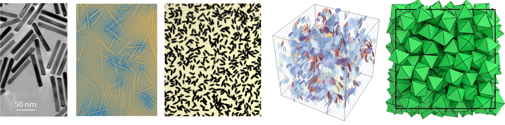
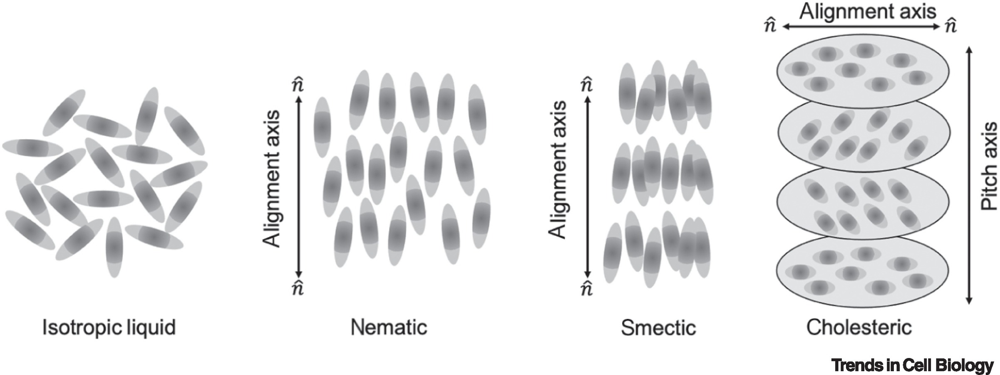
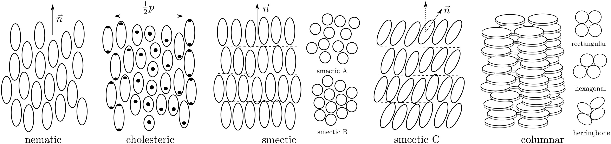
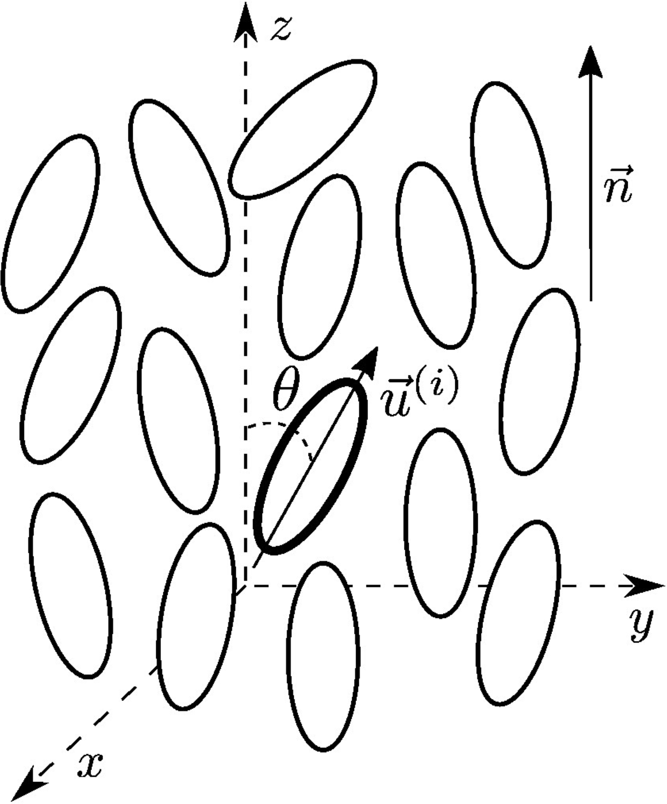

## Today

- Liquid crystals: orientational order without positional order
- Measuring order: the alignment tensor $\mathbf Q$ and the order parameter $\mathcal S$
- The isotropic–nematic transition: Landau–de Gennes theory

## What are Liquid Crystals?


- Intermediate phases between **liquids** and **crystals**
- Exhibit **orientational order** without full positional order
- Formed by **anisotropic particles** (rods, ellipsoids, plates)
- Key property: **decoupling** of orientational and translational degrees of freedom


## Types of Order

**Positional order**: Regular arrangement of particle positions (lattice)

**Orientational order**: Angular alignment of particles

| Phase | Positional | Orientational |
|-------|-----------|---------------|
| Crystal | Yes (3D) | Yes |
| Liquid | No | No |
| **Liquid Crystal** | **Partial/No** | **Yes** |

The strength of the ordering is determined by the **decay** of correlation functions:

- in liquids we have at best short range order (exponential decay of the oscillations in the $g(r)$)
- in crystals we have long-range order — correlations do not decay (sharp Bragg peaks in $S(\mathbf{k})$ and $g(r)$); this order is only disrupted by defects (dislocations, grain boundaries) on macroscopic scales

## Anisotropic Particles

Many natural and artificial systems have anisotropy




## Liquid Crystal Phases

:::{.columns}
:::{.column}
- **Isotropic fluid**: No long-range order (like normal liquids)
- **Nematic phase**: Orientational order, no positional order. 
- Particles align along a common direction: the **director** $\mathbf{n}$
- **Smectic phase**: Layered structure with orientational order
    - Positional order in 1D (layers)
  - Liquid-like within layers
:::
:::{.column}
- **Columnar phase**: Particles stack into columns
  - 2D positional order
- **Crystal**: Full 3D positional + orientational order
- **Chiral nematic (Cholesteric)**: Director forms a helix
:::
:::




---

## Phase Comparison

| Phase | Positional Order | Orientational Order |
|-------|-----------------|---------------------|
| Isotropic | No | No |
| Nematic | No | Yes (long-range) |
| Smectic | Yes (1D: layered) | Yes |
| Columnar | Yes (2D: columns) | Yes |
| Cholesteric | No | Yes (helical) |
| Crystal | Yes (3D: lattice) | Yes |




## Phase Comparison: Textures and Defects

![Examples of phases/textures: (a)  Nematic with surface point defects. (b) Thin nematic film on isotropic substrate. (c) Thread-like nematic texture. (d) Cholesteric fingerprint (helical axis in plane). (e) Short‑pitch cholesteric (standing helix) with vivid colors. (f) Long-range cholesteric DNA alignment in a magnetic field. (g, h) Focal conic textures of chiral smectic A. (i) Focal conic texture of chiral smectic C. (j) Hexagonal columnar spherulitic texture. (k) Rectangular discotic phase. (l) Hexagonal columnar phase. From Andrienko, Journal of Molecular Liquids (2018)](./figs/examplesLx.jpg)

## Orientation and director

:::{.columns}
:::{.column width=60%}
- Orientation of a rigid rod is described by a **unit vector** $\mathbf{u}$ along its long axis

- The nematic **phase** is head-tail symmetric (even when the molecules are not): $\mathbf{u}$ and $-\mathbf{u}$ are equivalent

- Because $\mathbf{u}$ and  $-\mathbf{u}$ are equiprobable, on average $$\langle \mathbf{u}\rangle=0$$

- Vectorial order parameter is zero. The next non-trivial invariant is a **second rank tensor**

<div style="font-size:0.75em">
| Tensor | Rank | Example order parameter |
|--------|------|-------------------------|
| Scalar | 0 | Density, temperature (no orientation) |
| Vector | 1 | Polarization or magnetization vector P / M (polar order) |
| Second‑rank tensor | 2 | Alignment tensor $Q_{ij}$ (nematic order); its largest eigenvalue is $\mathcal S$ |
| Third‑rank tensor | 3 | Octupolar / tetrahedral order $T_{ijk}$ |
</div>

:::
:::{.column width=40%}

:::
:::

## The Nematic Order Parameter

For **head-tail symmetric** rods, we cannot simply average orientations.

Instead, construct the **alignment tensor** 

$$
\mathbf{Q}=\dfrac{d}{d-1}\left\langle\mathbf{u}_i \otimes \mathbf{u}_i-\dfrac{1}{d}\mathbf{I}\right\rangle
$$

- we make it **traceless** by removing the identity
- we make it include quadratic combinations (it is a **second moment**, essentially the covariances)
- $\otimes$ is the outer product, giving a $d\times d$ matrix:
$$
\mathbf{u} \otimes \mathbf{u} =
\begin{pmatrix}
u_1 u_1 & u_1 u_2 & \cdots & u_1 u_d \\
u_2 u_1 & u_2 u_2 & \cdots & u_2 u_d \\
\vdots  & \vdots  & \ddots & \vdots  \\
u_d u_1 & u_d u_2 & \cdots & u_d u_d
\end{pmatrix}
$$

where $d$ is dimensionality, $\mathbf{u}_i$ is the unit orientation vector. For us, $d=2,3$

---

## Extracting Order

- Diagonalisation: the eigenvalues do not depend on the choice of axes, the eigenvectors give the principal directions


- **Largest eigenvalue** $\rightarrow$ scalar order parameter $\mathcal{S}$
- **Corresponding eigenvector** $\rightarrow$ director $\mathbf{n}$

$$
\mathcal{S} \in [0, 1]
$$

- $\mathcal{S} = 0$: isotropic (random orientations)
- $\mathcal{S} = 1$: perfect nematic order (all aligned)

:::{.callout-caution}
The nematic order parameter $\mathcal{S}$ should not be confused with the entropy $S$.
:::

## 2D Nematic Order Parameter

In two dimensions, the director is simply characterised by the angle $\psi$  expressed as 
$$
\psi = \frac{1}{2} \operatorname{atan2}(\langle\sin{2\theta_i}\rangle, \langle\cos{2\theta_i}\rangle).
$$
and the nematic order parameter is simply

$$
\mathcal{S}=\sqrt{\left\langle\cos 2 \theta_i\right\rangle^2+\left\langle\sin 2 \theta_i\right\rangle^2}
$$


## 3D Nematic Order Parameter

In 3D, choosing coordinates along director $\mathbf{n}$:

$$
\mathcal{S}=\dfrac{1}{2} \left\langle 3\cos ^2 \theta_i-1\right\rangle
$$

where $\theta_i$ is angle between particle $i$ and director.

This uses the **Legendre polynomial** $P_2(\cos\theta)$ to enforce head-tail symmetry.

- Lowest nontrivial rotationally‑invariant scalar that is even under $\mathbf{n}\to -\mathbf{n}$


| n | Legendre polynomial $P_n(x)$ | Head-tail symmetric? |
|---:|---------------------------|:---------------------:|
| 0 | $P_0(x)=1$ | Yes (even: $P_0(-x)=P_0(x)$) |
| 1 | $P_1(x)=x$ | No (odd: $P_1(-x)=-P_1(x)$) |
| 2 | $P_2(x)=\dfrac{1}{2}(3x^2-1)$ | Yes (even: $P_2(-x)=P_2(x)$) |
| 3 | $P_3(x)=\dfrac{1}{2}(5x^3-3x)$ | No (odd: $P_3(-x)=-P_3(x)$) |
| 4 | $P_4(x)=\dfrac{1}{8}(35x^4-30x^2+3)$ | Yes (even: $P_4(-x)=P_4(x)$) |


## Recall: Landau theory

Expand the free energy in powers of the order parameter $\phi$, small near the transition:

$$
f(\phi)=f_0+a_1\phi+a_2\phi^2+a_3\phi^3+a_4\phi^4
$$

| Term | Physical meaning |
|---|---|
| $f_0$ | free energy of the disordered phase: a constant, plays no role |
| $a_1\phi$ | coupling to an external field (tilts $f$); absent without a field |
| $a_2=\tilde a\,(T-T^*)$ | curvature at $\phi=0$: the disordered phase is **unstable** below $T^*$ |
| $a_3\phi^3$ | allowed only if $\phi$ and $-\phi$ are **physically different**: makes the transition **first order** |
| $a_4>0$ | keeps $f$ bounded and sets the size of $\phi$ in the ordered phase |

**Symmetry decides which terms appear**: a magnet ($m\to-m$) has $a_1=a_3=0$ and a continuous transition. Stop at the lowest even power that keeps $f$ bounded.

## Recall: Landau theory, interactive

```{ojs}
//| echo: false
viewof landau = Inputs.form({
  T: Inputs.range([0, 2], {label: "T / T*", value: 1.5, step: 0.01, width: 520}),
  a3: Inputs.range([-1, 1], {label: "cubic a₃", value: 0, step: 0.05, width: 520}),
  a1: Inputs.range([-0.3, 0.3], {label: "field a₁", value: 0, step: 0.01, width: 520})
})
```

```{ojs}
//| echo: false
landauMinima = (T, a3, a1) => {
  const a2 = T - 1, a4 = 1;
  // integer grid, symmetric about 0, so degenerate minima at ±φ* tie exactly
  const pts = d3.range(-260, 261).map(i => {const phi = i*0.005; return {phi, f: a1*phi + a2*phi**2 + a3*phi**3 + a4*phi**4};});
  const fmin = d3.min(pts, d => d.f);
  const minima = pts.filter((d, i) => i > 0 && i < pts.length - 1 && d.f <= pts[i-1].f && d.f < pts[i+1].f)
    .map(d => ({...d, T, stable: d.f - fmin < 1e-4}));
  return {pts, minima};
}
landauCurve = ({...landauMinima(landau.T, landau.a3, landau.a1), Tc: 1 + landau.a3**2/4})
landauBranches = d3.range(0, 2.0001, 0.005).flatMap(T => landauMinima(T, landau.a3, landau.a1).minima)
html`<div style="display:flex; gap:20px; align-items:flex-start">${
Plot.plot({
  width: 860, height: 450, marginLeft: 70, marginBottom: 50, marginTop: 40,
  style: {fontSize: "22px"},
  x: {label: "order parameter φ", domain: [-1.3, 1.3]},
  y: {label: "f − f₀", domain: [-0.6, 0.8]},
  marks: [
    Plot.ruleY([0], {stroke: "#bbb"}), Plot.ruleX([0], {stroke: "#bbb"}),
    Plot.line(landauCurve.pts, {x: "phi", y: "f", stroke: "steelblue", strokeWidth: 3, clip: true}),
    Plot.dot(landauCurve.minima, {x: "phi", y: "f", r: 9, stroke: "crimson", strokeWidth: 3, fill: d => d.stable ? "crimson" : "white"}),
    Plot.text(landauCurve.minima.filter(d => d.stable), {x: "phi", y: "f", text: d => `stable, φ = ${d.phi.toFixed(2)}`, dy: -26, fontSize: 20}),
    Plot.text(landauCurve.minima.filter(d => !d.stable), {x: "phi", y: "f", text: d => `metastable, φ = ${d.phi.toFixed(2)}`, dy: 30, fontSize: 20})
  ]
})}${
Plot.plot({
  width: 540, height: 450, marginLeft: 70, marginBottom: 50, marginTop: 40,
  style: {fontSize: "22px"},
  x: {label: "T / T*", domain: [0, 2]},
  y: {label: "minima φ", domain: [-1.1, 1.1]},
  marks: [
    Plot.ruleY([0], {stroke: "#bbb"}),
    Plot.dot(landauBranches.filter(d => !d.stable), {x: "T", y: "phi", r: 1.5, fill: "#bbb"}),
    Plot.dot(landauBranches.filter(d => d.stable), {x: "T", y: "phi", r: 2, fill: "crimson"}),
    Plot.ruleX([landau.T], {stroke: "steelblue", strokeWidth: 2, strokeDasharray: "6,4"})
  ]
})}</div>`
```

```{ojs}
//| echo: false
md`Filled dot: stable (global minimum); hollow dot: metastable (local minimum). Right: all minima against T (red stable, grey metastable; dashed line: current T). ${landau.a3 === 0 ? "With a₃ = 0 the minimum leaves φ = 0 continuously at T = T\\*." : `With a₃ ≠ 0 the minimum jumps at T_c = ${landauCurve.Tc.toFixed(2)} T\\* > T\\*.`} In Landau–de Gennes, φ = 𝒮 with a₂ = A/3, a₃ = −2B/27, a₄ = C/9.`
```

## Landau-de Gennes mean field theory

Using the tensorial order parameter one can express a Landau theory of the isotropic-to-nematic transition (the simplest form of orientational order appearing in liquid crystals).


For historical reasons, in 3D the alignment tensor of a uniaxial nematic is usually written as (equivalent to our definition up to a multiplicative factor)

$$
\mathbf{Q}=\mathcal{S}\left(\mathbf{n} \otimes \mathbf{n}-\frac{1}{3} \mathbf{I}\right)
$$

If we choose $z$ to be the axis along the director $\mathbf{n}$ then explicitly


$$
\mathbf{Q}=\mathcal{S}\left(\begin{array}{ccc}
-\frac{1}{3} & 0 & 0 \\
0 & -\frac{1}{3} & 0 \\
0 & 0 & \frac{2}{3}
\end{array}\right)
$$


## Landau-de Gennes mean field theory

The phenomenological Landau-de Gennes approach is to construct a **generic free energy density** as an expansion in scalar combinations of the tensor $\mathbf{Q}$ (of which $\mathcal{S}$ is an example)

$$
f=f_0+\frac{A}{2} Q_{i j} Q_{j i}-\frac{B}{3} Q_{i j} Q_{j k} Q_{k i}+\frac{C}{4}\left(Q_{i j} Q_{i j}\right)^2
$$
or in more compact form

$$
f=f_0+\frac{A}{2} \operatorname{tr} \mathbf{Q}^2-\frac{B}{3} \operatorname{tr} \mathbf{Q}^3+\frac{C}{4}\left(\operatorname{tr} \mathbf{Q}^2\right)^2
$$

- Notice that all the indices are contracted!
- $A, B, C$ are phenomenological constants (and cannot be immediately linked to microscopic properties of the anisotropic particles)

## Landau-de Gennes mean field theory

According to our earlier 3D definitions

$$
\operatorname{Tr}\left(\mathbf{Q}^2\right)=\frac{2}{3} \mathcal{S}^2 \quad,\quad
\operatorname{Tr}\left(\mathbf{Q}^3\right)=\frac{2}{9} \mathcal{S}^3
$$

So 
$$
f=f_0+\frac{A}{2} \operatorname{tr} \mathbf{Q}^2-\frac{B}{3} \operatorname{tr} \mathbf{Q}^3+\frac{C}{4}\left(\operatorname{tr} \mathbf{Q}^2\right)^2
$$
becomes
$$
f=f_0+\frac{A}{3}\mathcal{S}^2-\frac{2B}{27}\mathcal{S}^3+\frac{C}{9}\mathcal{S}^4
$$

## Landau-de Gennes theory result

- We can use the Landau phase transition approach. 
- We can **expand** $A,B,C$ around a reference temperature $T^\ast$ :

    - $A(T)=a\left(T-T_*\right)+\cdots$
    - $B(T)= b+\dots$
    - $C(T)=c+\dots$, with $a,b,c>0$: $c>0$ keeps $f$ bounded, $b>0$ favours $\mathcal S>0$ (rods along $\mathbf n$).

and obtain

$$
f-f_0=\frac{a}{3}\left(T-T^{\ast}\right) \mathcal{S}^2-\frac{2 b}{27} \mathcal{S}^3+\frac{c}{9} \mathcal{S}^4 .
$$

The cubic term implies that there is a **temperature range** where **two minima coexist**:

- $\mathcal{S}_1=0$: isotropic
- $\mathcal{S}_2>0$: nematic

**First order** transition:

- $\mathcal S$ and $-\mathcal S$ differ (rods along vs perpendicular to $\mathbf n$; unlike $\pm m$ in a magnet): the cubic term is allowed
- $\mathcal S$ jumps at $T_{NI}>T^*$
- at $T^*$, $f\sim \mathcal S^3$ rather than $\mathcal S^4$: less flat


## Landau-de Gennes theory result


:::{.columns}
:::{.column  width=60%}
```{pyodide}
#| echo: false
#| autorun: true
import numpy as np
import matplotlib.pyplot as plt
def plot(S,F):
    # Plot
    plt.figure(figsize=(6, 3))
    plt.plot(S, F, 'b-', linewidth=2)
    plt.axhline(y=0, color='k', linestyle='--', alpha=0.3)
    plt.xlabel('Order parameter S', fontsize=12)
    plt.ylabel('Free energy density $f - f_0$', fontsize=12)
    plt.grid(True, alpha=0.3)
    plt.tight_layout()
    plt.show()

```
```{pyodide}
T = 1.01  # working temperature
Tni = 1.0 #transition temperature
a = 1.0
b = 5.0
c = 3.0
T_star = Tni-b**2/(27*a*c)
# Order parameter range
S = np.linspace(0, 1, 200)
# Free energy density (setting f_0 = 0)
f = (a/3) * (T - T_star) * S**2 - (2*b/27) * S**3 + (c/9) * S**4
plot(S,f)
```
:::
:::{.column width=40%}
The transition temperature is 

$$
T_{N I}=T^{\ast}+\frac{b^2}{27 a c}
$$
 
while $T^{\ast}$ is a material dependent temperature, identifying instability (spinodal).

:::
:::
