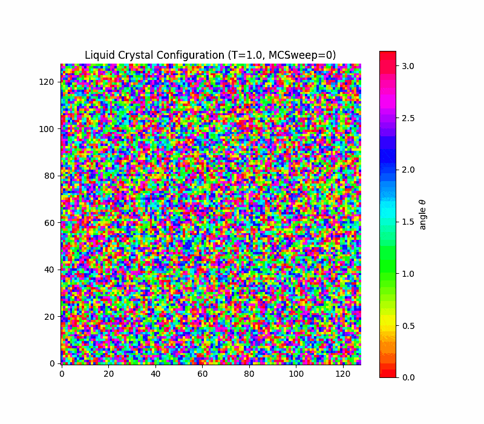
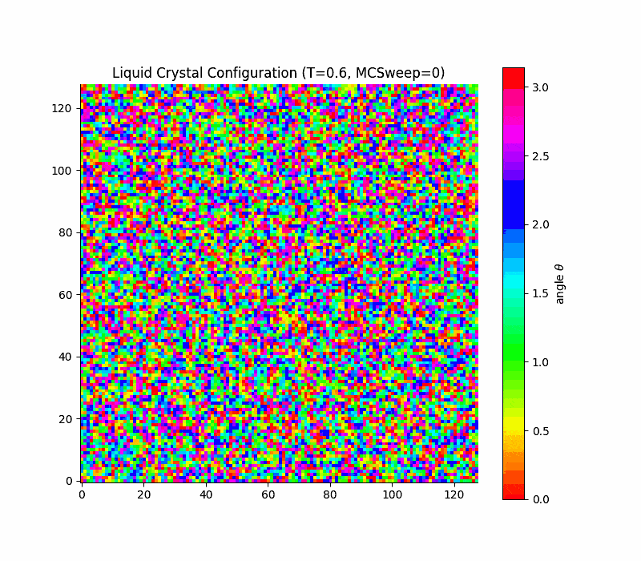
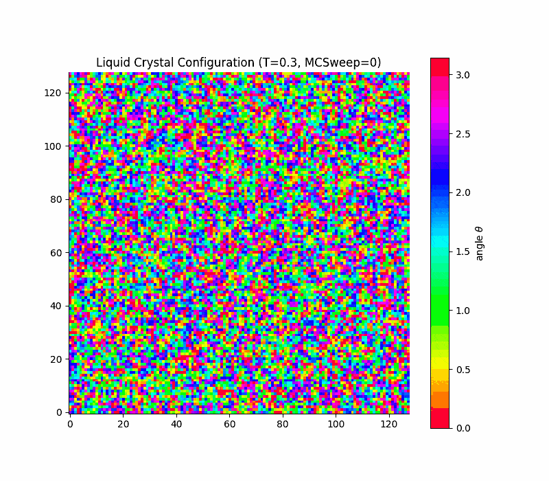
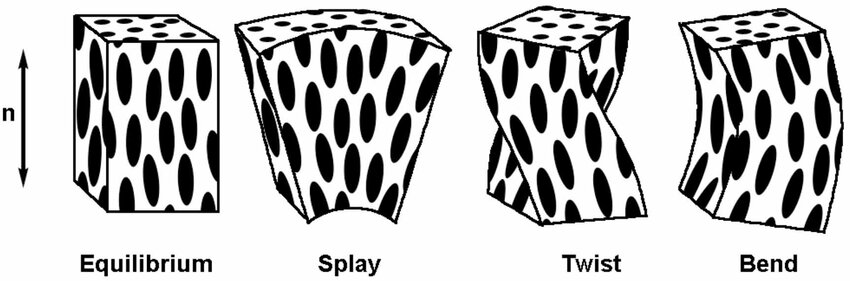
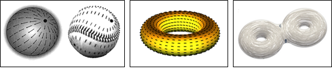
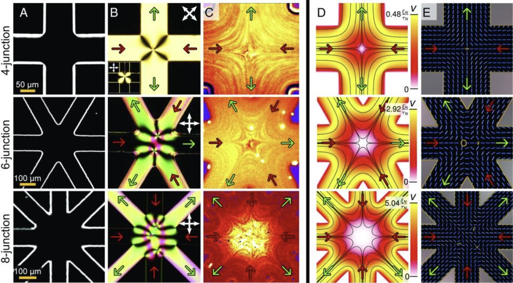
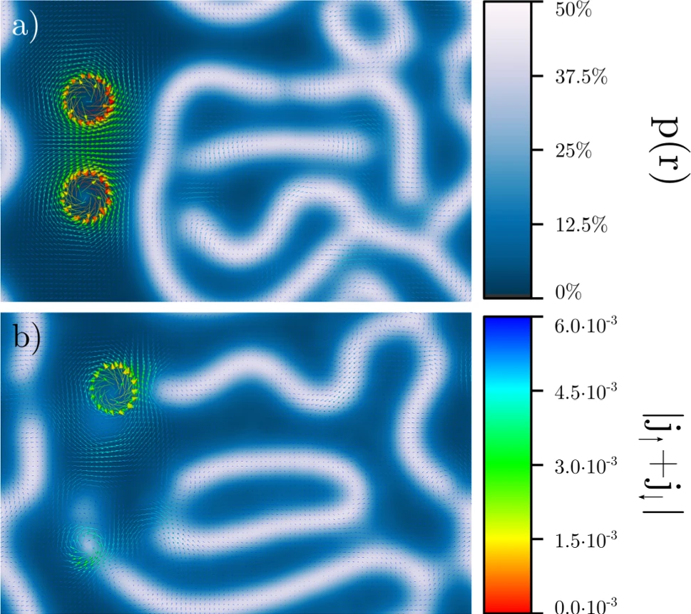
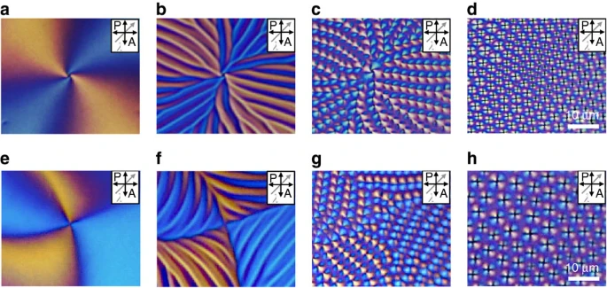
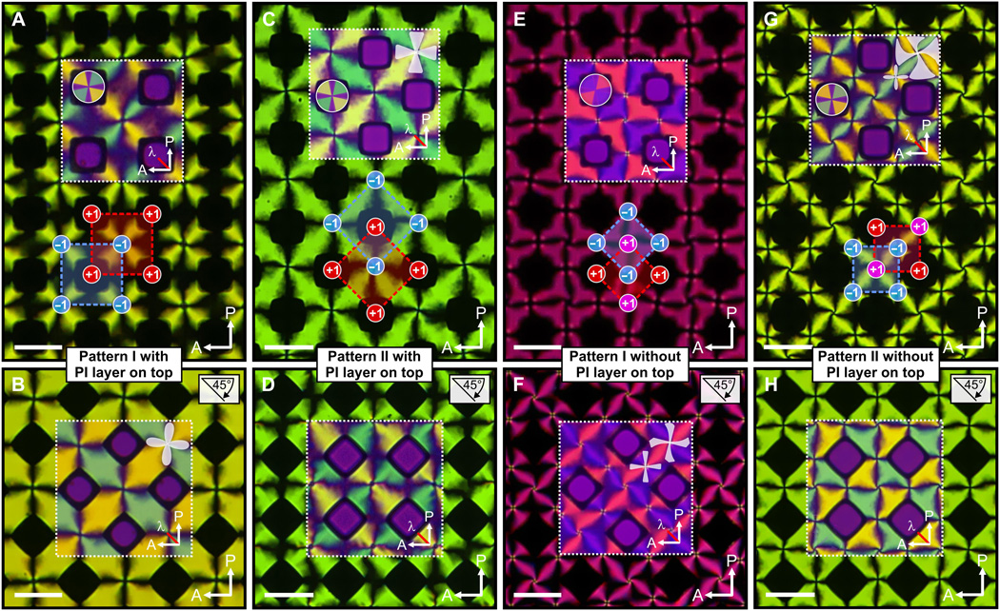
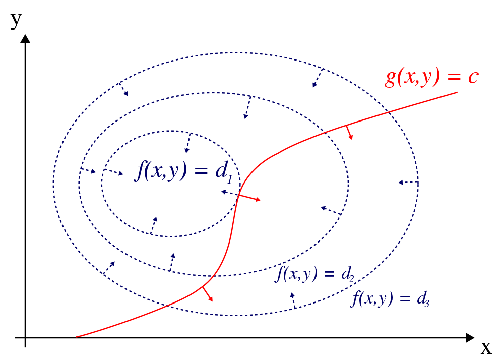

## Today

- Recap: Landau–de Gennes predicts a first-order isotropic–nematic transition
- Maier–Saupe: a microscopic mean-field theory
- Hard rods: order from entropy alone
- Lattice model, Frank elasticity, topological defects

## Maier-Saupe Theory of Nematic Liquid Crystals

- We saw the Landau-de Gennes free energy for nematic liquid crystals.$$
f-f_0=\frac{a}{3}\left(T-T^{\ast}\right) \mathcal{S}^2-\frac{2 b}{27} \mathcal{S}^3+\frac{c}{9} \mathcal{S}^4 .
$$


    - phenomenological (the coefficients are results of a perturbation)
    - based on symmetries only (rotational invariance, head-tail symmetry)
    - no molecular basis

- The **Maier-Saupe theory** is a simple alternative **microscopic** mean-field theory that gives us a more physical insight.

- The idea is to construct the free energy as we have done in various prior cases by identifying:

    - an entropic contribution
    - an energetic contribution

We need a microscopic description of the orientations:

- angular deviations $\theta$ from the director and their probability distribution $p(\theta)$
- a scalar orientational order parameter $\mathcal{S}$ 

## Orientational distribution and order parameter

Recall $\mathcal{S}=\langle P_2(\cos\theta)\rangle$, an average over particles. A microscopic theory needs instead the **probability distribution** $p(\Omega)$ of finding a rod with polar and azimuthal angles $\Omega=(\theta,\phi)$, with the polar axis along $\mathbf{n}$.

- The nematic phase has **cylindrical symmetry** around $\mathbf{n}$, so $p$ depends only on $\theta$.

So, by definition of an average, the orientational order parameter reads

$$\begin{aligned}\mathcal{S}&=\dfrac{3}{2}\left\langle(\mathbf{u} \cdot \mathbf{n})^2-\frac{1}{3}\right\rangle = \dfrac{1}{2}\langle 3 \cos^2\theta-1\rangle=\langle P_2(\cos\theta)\rangle\\
&=\int_0^{\pi}P_2(\cos\theta)p(\theta)\sin\theta d\theta
\end{aligned}$$
where we used the Jacobian in spherical coordinates and normalised $p(\theta)$ as $\int_0^\pi p(\theta)\sin\theta d\theta=1$.

## Maier-Saupe Theory of Nematic Liquid Crystals

### Energetic Contribution

- We assume molecules interact with an angular potential that depends on their orientations via a the second Legendre polynomial $P_2(x)=\frac{1}{2}\left(3 x^2-1\right)$:

$$
V\left(\Omega_i, \Omega_j\right)=-u P_2\left(\mathbf{u}_i \cdot \mathbf{u}_j\right)
$$


We can average over all possible orientations of molecule $j$ to get the mean-field potential felt by molecule $i$:
$$
U_i^{\mathrm{mf}}(\Omega)=\rho \int V\left(\Omega, \Omega^{\prime}\right) p\left(\Omega^{\prime}\right) d \Omega^{\prime}=-u \mathcal{S} P_2(\mathbf{u}_i \cdot \mathbf{n})
$$

where $\mathcal{S}$ is the order parameter defined above and $u$ is the energetic **coupling** (a scalar, which absorbs the density $\rho$; not to be confused with the unit vectors $\mathbf{u}_i$). 

Average  over all orientations of molecule $i$ to get the average interaction energy per molecule (and divide by 2 to avoid double counting):

$$U^{mf} =  -\dfrac{u}{2} \mathcal{S}^2$$

A potential that aligns molecules with the director, quadratic to reflect head-tail symmetry.


## Maier-Saupe Theory of Nematic Liquid Crystals

### Entropic contribution

The second contribution is **entropic** in nature.

Use the orientational distribution $p(\theta)$ introduced above (uniaxial symmetry around the director $\mathbf{n}$).

The usual Gibbs (or Shannon) entropy functional $-k_B \int p(\Omega)\ln p(\Omega) d\Omega$ contributes to the free energy as

$$
f_{\rm entropy }=k_B T \int_0^\pi p(\theta) \ln (2 p(\theta)) \sin \theta d \theta
$$

where $\sin \theta d \theta$ comes from the solid angle and the factor $2$ comes from the normalisation $\int_0^\pi p(\theta)\sin\theta d\theta=1$. [^1]


[^1]: Check that for the isotropic distribution $p(\theta)=1/2$ the entropy term is zero.

## Functional derivatives

- Both $\mathcal{S}[p]$ and $f[p]$ are **functionals**: they take a whole function $p(\theta)$ and return a number.

- For a discrete distribution $p_i$ we would write $dF=\sum_i \dfrac{\partial F}{\partial p_i}\,dp_i$. In the continuum $p_i\to p(\theta)$ and the sum becomes an integral, which **defines** the functional derivative:
$$
\delta F=\int \frac{\delta F}{\delta p(\theta)}\,\delta p(\theta)\,d\theta
$$

- The basic rule is the continuum version of $\partial p_j/\partial p_i=\delta_{ij}$:
$$
\frac{\delta p(\theta')}{\delta p(\theta)}=\delta(\theta-\theta')
$$

- Minimising $F$ means $\delta F=0$ for every small change $\delta p$, i.e. $\dfrac{\delta F}{\delta p(\theta)}=0$ at every $\theta$ (plus constraints).

## Functional derivatives: two rules

**1. Local rule.** If $F=\int_0^\pi G\big(p(\theta')\big)\,d\theta'$, differentiate the integrand with respect to $p$:
$$
\frac{\delta F}{\delta p(\theta)}=\frac{\partial G}{\partial p}\Big|_{\theta'=\theta}
$$

- Entropy: $\;f_{\rm entropy}=k_BT\displaystyle\int_0^\pi p(\theta')\ln\big(2p(\theta')\big)\sin\theta'\,d\theta'\;\Rightarrow\;\frac{\delta f_{\rm entropy}}{\delta p(\theta)}=k_BT\left(\ln\big(2p(\theta)\big)+1\right)\sin\theta$
- Order parameter: $\;\mathcal{S}=\displaystyle\int_0^\pi P_2(\cos\theta')\,p(\theta')\sin\theta'\,d\theta'\;\Rightarrow\;\frac{\delta \mathcal{S}}{\delta p(\theta)}=P_2(\cos\theta)\sin\theta$
- Normalisation: $\;\displaystyle\int_0^\pi p(\theta')\sin\theta'\,d\theta'\;\Rightarrow\;\sin\theta$

<br>

**2. Chain rule.** For a function of a functional, such as $\mathcal{S}^2$:
$$
\frac{\delta\, h(\mathcal{S})}{\delta p(\theta)}=h'(\mathcal{S})\,\frac{\delta \mathcal{S}}{\delta p(\theta)}
\qquad\Rightarrow\qquad
\frac{\delta \mathcal{S}^2}{\delta p(\theta)}=2\mathcal{S}\,P_2(\cos\theta)\sin\theta
$$

::: {.smaller}
Gradient terms $p'(\theta)$ need an integration by parts ([aside](#aside-optional-functional-derivatives-with-gradient-terms)).
:::

## Maier-Saupe Theory of Nematic Liquid Crystals

Together, we have the Maier-Saupe free energy functional per molecule

$$
f=f_0-u \frac{\mathcal{S}^2}{2}+k_B T \int_0^\pi p(\theta) \ln (2 p(\theta)) \sin \theta d \theta
$$

The only constraint is normalization of $p(\theta)$:
$$\int_0^\pi p(\theta) \sin \theta d \theta=1$$ where the $\sin \theta$ comes from the solid angle element.

Introduce the Lagrange multiplier $\lambda$ to enforce the constraint ([see the aside on Lagrange multipliers](#aside-optional-constrained-optimisation-with-lagrange-multipliers)) and minimize the functional and set the variation to zero:
$$
\delta\left[f+\lambda\left(\int_0^\pi p(\theta) \sin \theta d \theta-1\right)\right]=0
$$
Using the rules above for the constraint term:

$$
\frac{\delta f}{\delta p(\theta)}+\lambda \sin \theta=0
$$

## Maier-Saupe Theory of Nematic Liquid Crystals

Remember that - by **definition** -

$$\mathcal{S}=\left\langle P_2(\cos \theta)\right\rangle=\int_0^\pi P_2(\cos \theta) p(\theta) \sin \theta d \theta$$

so, by the chain rule for the energy and the local rule for the entropy,

$$\dfrac{\delta f}{\delta p} =-u\mathcal{S} P_2(\cos\theta)\sin\theta +k_BT\left(\ln(2 p(\theta)) + 1\right) \sin \theta $$

and hence, after simplifying $\sin \theta$, our Lagrange equation reads

$$-u \mathcal{S} P_2(\cos \theta)+k_B T(\ln (2 p(\theta))+1)+\lambda=0$$

Its solution yields 

$$p(\theta)=\frac{1}{Z} \exp \left(\frac{u \mathcal{S}}{k_B T} P_2(\cos \theta)\right)
$$

where the partition function $Z$ ensures normalization.


## Self-consistency in the Maier-Saupe Result

The solution is said to be **self-consistent** because $p(\theta)$ depends on $\mathcal{S}$, which in turn depends on $p(\theta)$.

The self-consistency condition is

$$
\mathcal{S} = \int_0^\pi P_2(\cos \theta) p(\theta) \sin \theta d\theta
$$

where $p(\theta)$ itself depends on $\mathcal{S}$:

$$
p(\theta) = \frac{1}{Z} \exp\left(\frac{u \mathcal{S}}{k_B T} P_2(\cos \theta)\right)
$$

This equation must be solved for $\mathcal{S}$ at each temperature $T$. 

In general, this requires a **numerical** solution (see problem classes for a special case where we can make progress analytically).

<br></br>

## Aside (optional): Maier-Saupe numerical solution

```{python}
#| echo: false

import numpy as np
import plotly.graph_objects as go
from plotly.subplots import make_subplots

# Integrals over the sphere in x = cos(theta): head-tail symmetry restricts to x in [0, 1]
x, wq = np.polynomial.legendre.leggauss(64)
x, wq = (x + 1) / 2, wq / 2
P2 = 1.5 * x**2 - 0.5

# Trial distributions p ∝ exp(lam P2); lam is the variational parameter
lam = np.concatenate([[0.0], np.geomspace(1e-2, 60, 300)])
E = np.exp(np.outer(lam, P2))
Z = E @ wq
S = (E * P2) @ wq / Z
ent = lam * S - np.log(Z)            # ∫ p ln(2p) sinθ dθ

def landscape(t):                     # f / k_B T, with t = k_B T / u
    return -S**2 / (2 * t) + ent

def extrema(f):
    d = np.diff(f)
    mins = [0] if d[0] > 0 else []    # S = 0 is stationary by symmetry
    maxs = [] if d[0] > 0 else [0]
    for k in range(1, len(f) - 1):
        if d[k - 1] < 0 <= d[k]:
            mins.append(k)
        elif d[k - 1] > 0 >= d[k]:
            maxs.append(k)
    fmin = min(f[k] for k in mins)
    stable = [k for k in mins if f[k] - fmin < 1e-9]
    meta = [k for k in mins if k not in stable]
    return stable, meta, maxs

# Self-consistent solutions S = <P2> with lam = S/t give t = S/lam exactly
tsol = S[1:] / lam[1:]
Ssol = S[1:]
i_sp = np.argmax(tsol)
t_sp = tsol[i_sp]                     # last temperature where the nematic minimum exists
upper = slice(i_sp, None)
f_nem = -Ssol[upper]**2 / (2 * tsol[upper]) + ent[1:][upper]
t_NI = np.interp(0, f_nem[::-1], tsol[upper][::-1])   # coexistence: f_nem = f_iso = 0
S_c = np.interp(t_NI, tsol[upper][::-1], Ssol[upper][::-1])

ts = np.unique(np.round(np.concatenate([np.arange(0.17, 0.2501, 0.002), np.arange(0.216, 0.2261, 0.0005)]), 4))
fig = make_subplots(rows=1, cols=2, horizontal_spacing=0.12)
red, grey = "crimson", "grey"

# Right panel: static branches
mask_s = tsol[upper] <= t_NI
fig.add_trace(go.Scatter(x=tsol[upper][mask_s], y=Ssol[upper][mask_s], mode="lines",
                         line=dict(color=red, width=3), name="stable"), 1, 2)
fig.add_trace(go.Scatter(x=tsol[upper][~mask_s], y=Ssol[upper][~mask_s], mode="lines",
                         line=dict(color=grey, width=3), name="metastable"), 1, 2)
fig.add_trace(go.Scatter(x=tsol[:i_sp + 1], y=Ssol[:i_sp + 1], mode="lines",
                         line=dict(color=grey, dash="dot"), name="unstable (maximum)"), 1, 2)
fig.add_trace(go.Scatter(x=[t_NI, ts[-1]], y=[0, 0], mode="lines",
                         line=dict(color=red, width=3), showlegend=False), 1, 2)
fig.add_trace(go.Scatter(x=[0.2, t_NI], y=[0, 0], mode="lines",
                         line=dict(color=grey, width=3), showlegend=False), 1, 2)
fig.add_trace(go.Scatter(x=[ts[0], 0.2], y=[0, 0], mode="lines",
                         line=dict(color=grey, dash="dot"), showlegend=False), 1, 2)
fig.add_trace(go.Scatter(x=[t_NI, t_NI], y=[0, S_c], mode="lines",
                         line=dict(color=red, dash="dash", width=1), showlegend=False), 1, 2)
n_static = len(fig.data)

# Per-temperature traces: curve, stable, metastable, maxima, current-T line
per = 5
for t in ts:
    f = landscape(t)
    st, me, mx = extrema(f)
    fig.add_trace(go.Scatter(x=S.round(4), y=f.round(5), mode="lines", line=dict(color="black"),
                             visible=False, showlegend=False), 1, 1)
    fig.add_trace(go.Scatter(x=S[st], y=f[st], mode="markers+text",
                             marker=dict(color=red, size=12),
                             text=[f"stable, 𝒮={abs(S[k]):.2f}" for k in st], textposition=["top right" if k == 0 else "top center" for k in st],
                             visible=False, showlegend=False), 1, 1)
    fig.add_trace(go.Scatter(x=S[me], y=f[me], mode="markers+text",
                             marker=dict(color="white", size=12, line=dict(color=red, width=2)),
                             text=[f"metastable, 𝒮={abs(S[k]):.2f}" for k in me], textposition=["bottom right" if k == 0 else "bottom center" for k in me],
                             visible=False, showlegend=False), 1, 1)
    fig.add_trace(go.Scatter(x=S[mx], y=f[mx], mode="markers",
                             marker=dict(color=grey, size=10, symbol="x"),
                             visible=False, showlegend=False), 1, 1)
    fig.add_trace(go.Scatter(x=[t, t], y=[-0.05, 1], mode="lines",
                             line=dict(color="black", dash="dash", width=1),
                             visible=False, showlegend=False), 1, 2)

def visible(j):
    v = [True] * n_static + [False] * per * len(ts)
    v[n_static + per * j: n_static + per * (j + 1)] = [True] * per
    return v

j0 = int(np.argmin(abs(ts - 0.22)))
for k, val in enumerate(visible(j0)):
    fig.data[k].visible = val
def yrange(t):
    f = landscape(t)[S < 0.85]
    return [min(-0.02, f.min() - 0.01), 0.04]

steps = [dict(method="update", args=[{"visible": visible(j)}, {"yaxis.range": yrange(t)}], label=f"{t:.4f}")
         for j, t in enumerate(ts)]
fig.update_layout(sliders=[dict(active=j0, steps=steps, currentvalue=dict(prefix="k<sub>B</sub>T/u = "),
                                pad=dict(t=80))],
                  height=560, width=1250, font=dict(size=20), template="simple_white", margin=dict(t=90, b=40),
                  legend=dict(orientation="h", x=0.5, xanchor="center", y=1.15))
fig.update_xaxes(title_text="order parameter 𝒮", range=[-0.02, 0.85], row=1, col=1)
fig.update_yaxes(title_text="(<i>f</i> − <i>f</i><sub>iso</sub>) / <i>k</i><sub>B</sub><i>T</i>", range=yrange(ts[j0]), row=1, col=1)
fig.update_xaxes(title_text="<i>k</i><sub>B</sub><i>T</i> / <i>u</i>", range=[ts[0], ts[-1]], row=1, col=2)
fig.update_yaxes(title_text="𝒮", range=[-0.05, 1], row=1, col=2)
fig.show()
```

::: {.smaller}
Filled dot: stable; hollow: metastable; cross: maximum. At $k_BT_{NI}\approx0.220\,u$ the minima have equal height and $\mathcal{S}$ jumps from $0$ to $\approx0.43$: first order. [🪁 Notes](https://fturci.github.io/course-disordered-matter/soft-matter/soft-matter_liquidcrystals.html#maier-saupe-theory)
:::


## Quick comparison Maier-Saupe vs Landau-de Gennes

- Both theories predict a first-order isotropic-nematic phase transition with a discontinuous jump in the order parameter $\mathcal{S}$.
- Landau-de Gennes is phenomenological, Maier-Saupe is microscopic.
- Maier-Saupe provides a molecular basis for the coefficients in Landau-de Gennes
- Both theories can be extended to include spatial variations in the order parameter and director field, leading to descriptions of defects and elasticity in nematic liquid crystals.
- Maier-Saupe requires self-consistency requirement, while Landau-de Gennes is often simpler to analyze analytically: (slightly) harder numerics.
- Easier to cast Maier Saupe onto a lattice model (Lebwohl-Lasher).


## Hard rods: ordering from entropy alone

Maier-Saupe needs $u\neq 0$. But even **hard rods**, with no attractions at all, go from **isotropic** to **nematic** at high density (Onsager, 1949): the transition is **purely entropic**.

Two entropic contributions compete:

- **orientational entropy** favours the **isotropic** phase: aligning reduces the available orientations
- **translational entropy** favours the **nematic** phase: aligned rods exclude less volume to each other, so each rod has more free volume to move in

At high density the translational gain wins: the nematic phase has the **higher** total entropy.

:::{.callout-note}
Same story as the freezing of hard spheres: the spheres lose the disorder of their positions, but each gains free volume to vibrate around its lattice site.
:::


## Aside (optional): simple lattice model, Lebwohl-Lasher

- A way to construct a Maier-Saupe-like model on lattice.
- Vectors on a lattice represent the orientations of molecules.
- Nearest-neighbor interactions favor alignment of neighboring vectors.


In 2D

$$
H=-\epsilon \sum_{\langle i, j\rangle}\left[\frac{3}{2} \cos ^2\left(\theta_i-\theta_j\right)-\frac{1}{2}\right]$$


🪁 Demonstration in class

## Aside (optional): simple lattice model, Lebwohl-Lasher

::: {.columns}

::: {.column width="33%"}

:::

::: {.column width="33%"}

:::

::: {.column width="33%"}

:::

:::

In 2D, $\frac32\cos^2\Delta\theta-\frac12=\frac34\cos2\Delta\theta+\frac14$: the model is the XY model (planar spins) for the angle $2\theta$.

- no true long-range order at $T>0$ (Mermin–Wagner, below)
- at low $T$, orientational correlations decay as a power law (**quasi-long-range order**) rather than exponentially
- the transition happens when bound $\pm\tfrac12$ defect pairs unbind (Kosterlitz–Thouless; defects later today)


> **(Mermin-Wagner theorem)** Continuous symmetries **cannot be spontaneously broken** at finite temperature in systems with sufficiently short-range interactions in dimensions $d \leq 2$.

Here the continuous symmetry is the rotational invariance of the director field in the plane.

## Continuum limit and Frank elasticity

Charles Frank (1958, of our Frank lecture theatre) developed a continuum theory to describe the elastic properties of nematic liquid crystals.

The Frank free energy density describes the cost of spatial variations in the director field $\mathbf{n}(\mathbf{r})$:

$$
f_{\text{Frank}} = \frac{1}{2} K_1 (\nabla \cdot \mathbf{n})^2 + \frac{1}{2} K_2 (\mathbf{n} \cdot \nabla \times \mathbf{n})^2 + \frac{1}{2} K_3 (\mathbf{n} \times \nabla \times \mathbf{n})^2
$$  

-  $K_1$: **splay** elastic constant
-  $K_2$: **twist** elastic constant
-  $K_3$: **bend** elastic constant



With this free energy, one can model large-scale deformations and **defects** in nematic liquid crystals.

## Topological Defects in Nematic Liquid Crystals

- We are working in the continuum with a director field $\mathbf{n}(\mathbf{r})$ that describes the local average orientation of molecules.
- In this framework, defects are **singularities** of the field, called **disclinations**

- Examples in 2D:
```{python}
#| echo: false

#| code-fold: true
import numpy as np
import matplotlib.pyplot as plt

def plot_half_defect(ax, charge, title):
    # Grid
    x = np.linspace(-1, 1, 21)
    y = np.linspace(-1, 1, 21)
    X, Y = np.meshgrid(x, y)

    # Polar coordinates
    theta = np.arctan2(Y, X)

    # Director angle for nematic disclination
    # Only ±1/2 defects
    phi = charge * theta  # charge = +0.5 or -0.5

    # Director vectors (head-tail symmetry)
    U = np.cos(phi)
    V = np.sin(phi)
    mask = U < 0
    U[mask] *= -1
    V[mask] *= -1

    # Plot director field as short lines
    ax.quiver(
        X, Y, U, V,
        pivot='middle', color='black',
        scale=18, headwidth=0, headlength=0, headaxislength=0
    )

    # Defect core
    ax.plot(0, 0, 'o', color='orange', markersize=12)

    ax.set_title(title, fontsize=12)
    ax.set_aspect('equal')
    ax.set_xlim(-1.1, 1.1)
    ax.set_ylim(-1.1, 1.1)
    ax.set_xticks([])
    ax.set_yticks([])
    ax.axis('off')

# Plotting
fig, axs = plt.subplots(1, 4, figsize=(15, 8))
charges = [0.5, -0.5, +1, -1]
titles = ["+1/2 defect", "-1/2 defect", "+1 defect",  "-1 defect"]

for ax, charge, title in zip(axs, charges, titles):
    plot_half_defect(ax, charge, title)

plt.tight_layout()
plt.show()

```

- These singularities cannot be removed by any smooth deformation of the field: they are **topologically protected**.

- To make them vanish, one needs oppositely signed defects to bring together so that they **annihilate** each other.

- At finite temperature, defects are spontaneously created/annihilated. 

## Topological Charge of a Defect

- The topological charge (or winding number) $s$ of a defect quantifies how many times the director field rotates by $2\pi$ when encircling the defect once.

$$\Delta \theta=2 \pi s$$

For example, a charge of $s=1/2$ is a rotation by $\pi$ is performed when going around the defect once.

```{python}
#| echo: false
import numpy as np
import matplotlib.pyplot as plt

def plot_charge_steps(ax, charge, step_frac, title=None):
    # Grid
    x = np.linspace(-1, 1, 20)
    y = np.linspace(-1, 1, 20)
    X, Y = np.meshgrid(x, y)
    theta = np.arctan2(Y, X)
    phi = charge * theta
    U = np.cos(phi)
    V = np.sin(phi)
    # Nematic symmetry
    U2 = np.where(U < 0, -U, U)
    V2 = np.where(U < 0, -V, V)
    ax.quiver(X, Y, U2, V2, pivot='middle', color='k', scale=30, headwidth=0, headlength=0, headaxislength=0, linewidth=0.7, linestyle='dashed')
    # Defect core
    ax.plot(0, 0, 'o', color='orange', markersize=10)
    # Draw circle and arc
    circle_r = 0.7
    t = np.linspace(0, 2*np.pi, 200)
    ax.plot(circle_r*np.cos(t), circle_r*np.sin(t), color='gray', lw=1, alpha=0.5)
    # Arc for winding
    arc_t = np.linspace(0, 2*np.pi*step_frac, 100)
    ax.plot(circle_r*np.cos(arc_t), circle_r*np.sin(arc_t), color='crimson', lw=5)
    # Arrowhead to show progress
    if step_frac > 0:
        arrow_theta = 2*np.pi*step_frac
        ax.arrow(circle_r*np.cos(arrow_theta), circle_r*np.sin(arrow_theta),
                 -0.08*np.sin(arrow_theta), 0.08*np.cos(arrow_theta),
                 head_width=0.06, head_length=0.12, fc='crimson', ec='crimson')
    # Director rotation calculation
    total_angle = charge * 2*np.pi * step_frac
    # Format for display
    angle_deg = np.rad2deg(total_angle)
    if title is None:
        title = f"Progress: $0 \\to {step_frac:.2f}\\times 2\\pi$\nDirector rotates: {total_angle:.2f} rad ({angle_deg:.1f}°)"
    else:
        title = f"{title}\nDirector rotates: {total_angle:.2f} rad ({angle_deg:.1f}°)"
    ax.set_title(title, fontsize=10)
    ax.set_aspect('equal')
    ax.set_xticks([])
    ax.set_yticks([])
    ax.set_xlim(-1.1, 1.1)
    ax.set_ylim(-1.1, 1.1)
    ax.axis('off')

fig, axs = plt.subplots(1, 3, figsize=(15, 7))
steps = [1/6, 0.5, 1.0]
titles = [
    "Start winding: $0 \\to \\pi/3$",
    "Halfway: $0 \\to \\pi$",
    "Full loop: $0 \\to 2\\pi$"
]
for ax, frac, title in zip(axs, steps, titles):
    plot_charge_steps(ax, 0.5, frac, title)
plt.tight_layout()
plt.show()
```

## Aside (optional): conservation of topological charge

- Topological charge is **conserved**: the total charge in a closed system remains constant over time.
- Defects can be created or annihilated only **in pairs** of opposite charge (e.g., +1/2 and -1/2).
- The **topology** of the space imposes such constraints of conservation via the *Poincaré-Hopf theorem*, which states

> The total topological charge of the defects in a field confined to a compact space is equal to the Euler characteristic of that space

In practice:

- **sphere** ($\chi=2$): total charge $+2$ (e.g. four $+\tfrac12$)
- **torus** ($\chi=0$): total charge $0$, as in periodic boxes
- **disc** ($\chi=1$), director tangent to the edge: total charge $+1$

- This imposes constraints on the dynamics and interactions of defects.




## Aside (optional): topological defects
:::{.columns}
:::{.column}
Analogies well-beyond liquid crystals:

- vortices in superfluids and superconductors
- dislocations in crystals
- electromagnetic field configurations
- flow fields microfluidic junctions


:::
:::{.column}

:::
:::
## Aside (optional): defects in 3 dimensions

- In 3D the disclinations become **lines**
- The director field wraps around the line defect in a similar way as in 2D.
- only **one** type of stable line: integer lines "escape into the third dimension"
- new **point defects** (hedgehogs), closed loops and complex textures


```{python}
#| echo: false
import numpy as np
import plotly.graph_objects as go

# 3D grid
x = np.linspace(-1, 1, 10)
y = np.linspace(-1, 1, 10)
z = np.linspace(-1, 1, 10)
X, Y, Z = np.meshgrid(x, y, z, indexing='ij')

# Twist rate along z
k = 4 * np.pi  # 2 full twists from z=-1 to z=1

# Twisting director field
phi = np.arctan2(Y, X) + k * Z
U = np.cos(phi / 2)
V = np.sin(phi / 2)
W = np.zeros_like(U)  # Still planar vectors, but twisting

# Mask to avoid core
mask = np.sqrt(X**2 + Y**2) > 0.2
x0 = X[mask].flatten()
y0 = Y[mask].flatten()
z0 = Z[mask].flatten()
u = U[mask].flatten()
v = V[mask].flatten()
w = W[mask].flatten()

# Director line segment
L = 0.2
x1 = x0 - L * u / 2
x2 = x0 + L * u / 2
y1 = y0 - L * v / 2
y2 = y0 + L * v / 2
z1 = z0 - L * w / 2
z2 = z0 + L * w / 2

# Plot
fig = go.Figure()


# Add symmetric director lines
for i in range(len(x0)):
    fig.add_trace(go.Scatter3d(
        x=[x1[i], x2[i]], y=[y1[i], y2[i]], z=[z1[i], z2[i]],
        mode='lines',
        line=dict(color='green', width=4),
        showlegend=False
    ))

# Helical disclination core: x = r cos(kz), y = r sin(kz)
r_core = 0.05
z_core = np.linspace(z.min(), z.max(), 200)
x_core = r_core * np.cos(k * z_core)
y_core = r_core * np.sin(k * z_core)

fig.add_trace(go.Scatter3d(
    x=x_core, y=y_core, z=z_core,
    mode='lines',
    line=dict(color='orange', width=6),
    name='Helical Disclination Core'
))

# Layout
fig.update_layout(
    scene=dict(
        xaxis=dict(visible=False),
        yaxis=dict(visible=False),
        zaxis=dict(visible=False),
        aspectmode='cube'
    ),
    margin=dict(l=0, r=0, b=0, t=30),
    title="3D Twisting Nematic Disclination Line"
)

fig.show()
```

## Aside (optional): defects and phase transitions

Defects control the stability and dynamics of nematic liquid crystals and can drive transitions between phases.



## Aside (optional): complex disclination patterns

Example from Kim et al Science Advances (2018)




## Summary: liquid crystals {.smaller .scrollable}

| Topic | Key result |
|---|---|
| Alignment tensor | $\mathbf Q=\frac{d}{d-1}\left\langle\mathbf u_i\otimes\mathbf u_i-\frac1d\mathbf I\right\rangle$: head-tail symmetry needs a tensor |
| Order parameter, director | $\mathcal S$ = largest eigenvalue of $\mathbf Q$, $\mathbf n$ = its eigenvector; 3D: $\mathcal S=\langle P_2(\cos\theta)\rangle$ |
| Landau-de Gennes | $f-f_0=\frac a3(T-T^*)\mathcal S^2-\frac{2b}{27}\mathcal S^3+\frac c9\mathcal S^4$: cubic term, first order |
| Maier-Saupe | $p(\theta)\propto\exp\left(\frac{u\mathcal S}{k_BT}P_2(\cos\theta)\right)$, self-consistent, weakly first order |
| Hard rods | purely entropic: orientational entropy lost, translational entropy gained |
| Lebwohl-Lasher | lattice Maier-Saupe; in 2D only quasi-long-range order |
| Frank elasticity | splay $K_1$, twist $K_2$, bend $K_3$ |
| Topological defects | $\Delta\theta=2\pi s$, $s=\pm\frac12,\pm1$; annihilate in $\pm$ pairs |

[Full summary with links in the notes](https://fturci.github.io/course-disordered-matter/soft-matter/soft-matter_liquidcrystals.html#summary){target="_blank"}

## Aside (optional): constrained optimisation with Lagrange multipliers

Many physics problems can be cast in terms of constrained optimisation

| Area | Problem | Constraint |
|------|---------|-----------|
| **Mechanics** | Minimize potential energy of a pendulum | Fixed length of the string |
| **Thermodynamics** | Maximize entropy $S$ | Fixed total energy $E$ |
| **Statistical Mechanics** | Maximize Gibbs entropy $-\sum_i p_i\ln p_i$ | Normalisation $\sum_i p_i=1$, fixed $\langle E\rangle$ |
| **Liquid Crystals** | Minimize Frank energy | Director normalization $\|\mathbf{n}\|=1$ |
| **Liquid Crystals** | Minimize Maier-Saupe free energy $f[p]$ | Normalisation of $p(\theta)$ |

**Method**: Use **Lagrange multipliers** $\lambda$ to convert constrained into unconstrained problem:
$$\mathcal{L}=f(\mathbf{x})-\lambda g(\mathbf{x})$$
then solve $\nabla\mathcal{L}=0$.


## Aside (optional): geometrical understanding of Lagrange multipliers

- Take a function $f(x,y)$.
- A constraint is expressed by fixing the value of a second function $g(x,y)=c$
- We want to find the extrema of $f(x,y)$ subject to the constraint $g(x,y)=c$: It has to be a curve
- This means find the extremal values of $f$ on the curve $\mathcal{C}: g(x,y)=c$
- We could parametrise $\mathcal{C}$ but we can also simply think in terms of its geometrical features.

## Aside (optional): geometrical understanding of Lagrange multipliers

Take the example of a minimum:

- at every point of $\mathcal{C}$ there is a tangent vector $\vec{t}$
- we want to find the points on $\mathcal{C}$ where $f$ is minimal. This means that *changes of f* along $\mathcal{C}$ are minimal.
- we can calculate such changes as the projection of the local gradient with the tangent vector and state that $\vec{\nabla}f \perp \vec{t}$
- Notice that, by definition, $\vec{\nabla}g\perp \vec{t}$
- So we are simply saying that

$$\vec{\nabla}f\parallel \vec{\nabla}g\to \vec{\nabla}f=\lambda\vec{\nabla}g$$

for some scalar $\lambda$.

## Aside (optional): example

{height=430}

## Aside (optional): many variables, example of probabilities

**Discrete case**: Find extremum of entropy
$$
S = -\sum_i p_i \ln p_i
$$
with constraints 
$$
\sum_i p_i = 1 \quad 
\sum_i p_i E_i = \langle E \rangle
$$

Using Lagrange multipliers:
$$
\mathcal{L} = -\sum_i p_i \ln p_i - \lambda_1 \left(\sum_i p_i - 1\right) - \lambda_2 \left(\sum_i p_i E_i - \langle E \rangle\right)
$$

Setting $\frac{\partial \mathcal{L}}{\partial p_i} = 0$:
$$
-\ln p_i - 1 - \lambda_1 - \lambda_2 E_i = 0 \quad \Rightarrow \quad p_i = \exp(-\lambda_2 E_i - \lambda_1 - 1)
$$

This is the **Boltzmann distribution**: $p_i \propto \exp(-\beta E_i)$ with $\beta = \lambda_2$.

## Aside (optional): functional derivatives with gradient terms

- When the functional depends also on the gradient $\phi'$, as for an **action functional** $S[\phi]$ (that you may have already seen), the rules of the main slides need an integration by parts:

$$S[\phi] = \int \ell(\phi(x), \phi'(x), x) dx$$

$\ell$ is the **Lagrangian density**: e.g.  $x$ is space,  $\phi(x)$ a field defined over space (e.g. density)

- Perturb $S[\phi]$ by an amount $\epsilon$ with an arbitrary function $\eta(x)$ vanishing at the boundaries

$$S[\phi+\epsilon\eta]=\int \ell(\phi+\epsilon\eta, \phi'+\epsilon\eta', x) dx$$

Expanding to first order in $\epsilon$:

$$S[\phi+\epsilon\eta]\approx S[\phi]+\epsilon\int\left[\frac{\partial \ell}{\partial \phi}\eta+\frac{\partial \ell}{\partial \phi'}\eta'\right] dx$$

## Aside (optional): functional derivatives with gradient terms
Integrating by parts the second term:

$$\int\frac{\partial \ell}{\partial \phi'}\eta' dx = \left[\frac{\partial \ell}{\partial \phi'}\eta\right]_{\text{boundary}}^{\phantom{x}}-\int\frac{d}{dx}\left(\frac{\partial \ell}{\partial \phi'}\right)\eta dx$$


Since $\eta(x)$ vanishes at the boundaries, the first term drops out, giving:

$$
\delta S=\int\left[\frac{\partial \ell}{\partial \phi}-\frac{d}{d x}\left(\frac{\partial \ell}{\partial \phi^{\prime}}\right)\right] \eta(x) d x
$$

If we want $S[\phi]$ to be stationary with respect to arbitrary perturbations $\eta(x)$, then $\delta S=0$  for all $\eta(x)$. 


This leads to the **Euler-Lagrange equation**:

$$\frac{\partial \ell}{\partial \phi}-\frac{d}{d x}\left(\frac{\partial \ell}{\partial \phi^{\prime}}\right)=0$$

which defines the functional derivative as 
$$\frac{\delta S}{\delta \phi(x)}=\frac{\partial \ell}{\partial \phi}-\frac{d}{d x}\left(\frac{\partial \ell}{\partial \phi^{\prime}}\right)$$

## Aside (optional): continuous limit

Replace sums with integrals. Let $p_i \to p(x)$ where $x$ is a continuous variable.

Constraints become:
$$
\int p(x) dx = 1, \quad \int p(x) E(x) dx = \langle E \rangle
$$

Entropy functional:
$$
S[p] = -\int p(x) \ln p(x) dx
$$

Lagrangian:
$$
\mathcal{L} = -\int p(x) \ln p(x) dx - \lambda_1 \left(\int p(x) dx - 1\right) - \lambda_2 \left(\int p(x) E(x) dx - \langle E \rangle\right)
$$

Functional derivative $\frac{\delta \mathcal{L}}{\delta p(x)} = 0$:
$$
-\ln p(x) - 1 - \lambda_1 - \lambda_2 E(x) = 0 \quad \Rightarrow \quad p(x) = \exp(-\beta E(x) - c)
$$
