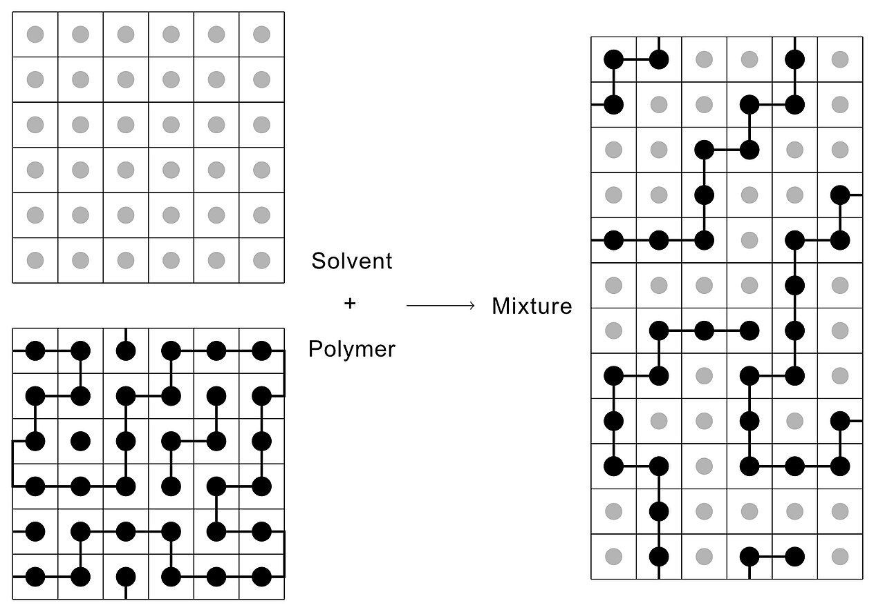
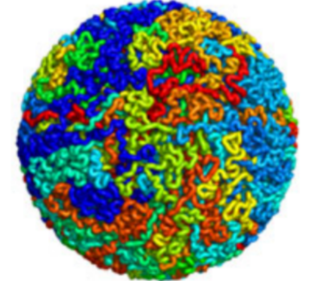
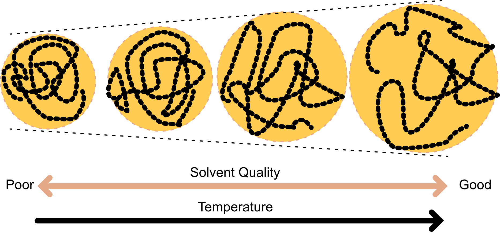
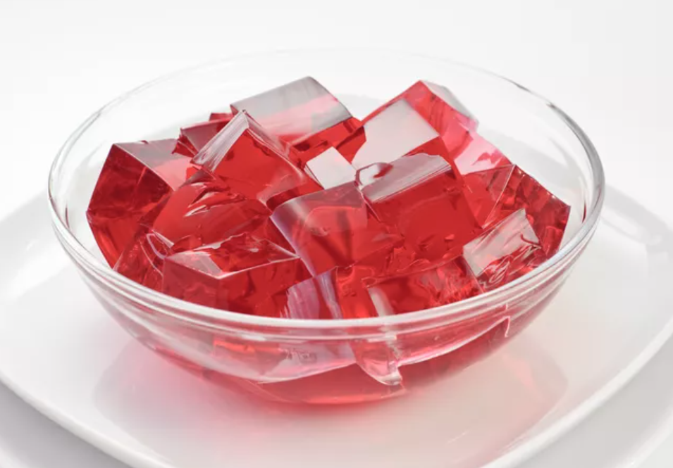
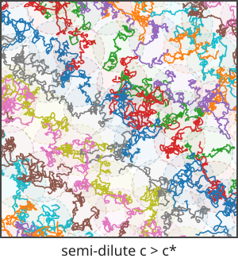
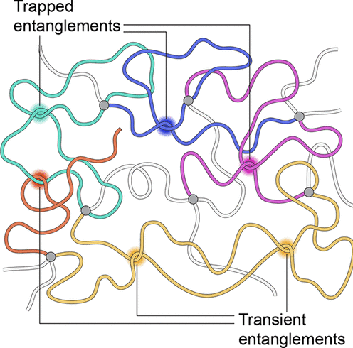
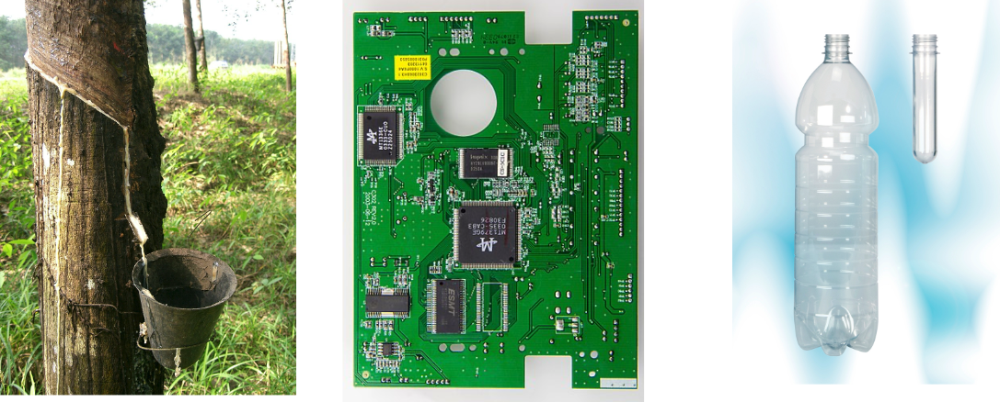
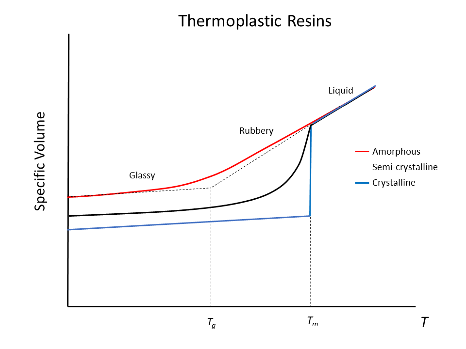

## Today

- Good, poor and theta solvents
- Concentrated polymer solutions

## Polymers in solvents

- Polymers typically are dispersed in a medium (**solvent**).
- Solvent-polymer attractions (the **affinity**) influences the polymer conformations:

    - **good solvents** $\to$ high affinity $\to$ the polymer swells (expands)
    - **poor solvents**  $\to$ low affinity $\to$  the polymer shrinks

    The affinity depends on the details of the molecular interactions but can be *coarse-grained*. 
    
    We can construct a simple model with **effective interaction energies**

- $\varepsilon_{s s}$ for the solvent-solvent 
- $\varepsilon_{\mathrm{pp}}$ for monomer-monomer 
-  $\varepsilon_{s p}$ for solvent-monomer interactions.

## Energy of mixing
:::{.columns}
:::{.column}
**On-lattice model**:

- each site has $z$ nearest neighbours
-  $N_{s}$ solvent molecules 
- $N_{p}$ monomers
- $\mathrm{N}_{\mathrm{sp}}$ solvent-monomer contacts.

**Effective interactions:**

- $\varepsilon_{s s}$ for the solvent-solvent 
- $\varepsilon_{\mathrm{pp}}$ for monomer-monomer 
-  $\varepsilon_{s p}$ for solvent-monomer interactions.
:::
:::{.column}

:::
:::
Then the energy of mixing $\Delta U_{\operatorname{mix}}$ is obtained as the difference between the total energy $U$ of the mixed system and the sum of the energies of the **pure solvent** and **pure polymer**, $U_{S}+U_{p}$.

$$
\Delta U_{\operatorname{mix}}=U-\left(U_{S}+U_{p}\right)
$$

## Energy of mixing
:::{.columns}
:::{.column}
- Energy of pure solvent  $$U_{s}=\frac{z N_{s} \varepsilon_{s s}}{2}$$

- Energy of pure polymer  $$U_{p}=\frac{z N_{p} \varepsilon_{p p}}{2}$$

:::
:::{.column}

:::
:::

**Energy of solution**
$U=N_{s p} \varepsilon_{s p}+\dfrac{\left(z N_{s}-N_{s p}\right) \varepsilon_{s s}}{2}+\dfrac{\left(z N_{p}-N_{s p}\right) \varepsilon_{p p}}{2}$

We obtain that the **energy of mixing** $\Delta U_{\mathrm{mix}}=N_{s p}\left[\varepsilon_{s p}-\dfrac{1}{2}\left(\varepsilon_{s s}+\varepsilon_{p p}\right)\right]$

which can **change sign** depending on our choices for the effective interaction energies.

## Good solvents, poor solvents and theta solvents

- **Good solvent**: $\varepsilon_{s p}<\frac{1}{2}\left(\varepsilon_{s s}+\varepsilon_{p p}\right) \quad \therefore \Delta \mathrm{U}_{\text {mix }}<0$

This is the case of a 'good solvent', because the monomers prefer to be near the solvent molecules. Excluded volume effects then expand the chain.

- **Poor solvent**: $\varepsilon_{s p}>\frac{1}{2}\left(\varepsilon_{s s}+\varepsilon_{p p}\right) \quad \therefore \Delta \mathrm{U}_{\text {mix }}>0$

The attraction between the different monomers offset the excluded volume effect making the polymer collapse.

:::{.columns}
:::{.column width="70%"}
Collapsed chains: hydrophobic polypeptides, polystyrene in water, chromatin in the cell nucleus.
:::
:::{.column width="30%"}
{height=220}
:::
:::

- Tuning solvent properties (e.g. the temperature) leads to **conformational changes**

## Temperature dependence and theta ($\Theta$) solvents

The various affinities have temperature dependencies. Typically:

- At high $T$, the coil expand and the solvent is *good*
- At low $T$ the coil collapses and phase separation is observed (polymer-rich from polymer-poor phase)
- There is an intermediate temperature where the excluded volume and attractive interaction compensate each other and  allow for the polymer to behave like an ideal chain (freely jointed chain). 

    - The temperature is conventionally named $\Theta$ temperature (or *Flory* temperature, after physicist Paul Flory)
    - The $\Theta$ temperature increases with the effective monomer-monomer attractions (we need higher temperature to reach ideal behaviour)

## Examples

:::{.columns}
:::{.column}
- Example: Food polymer — gelatine (from collagen) in water

    - Good solvent (hot water): gelatin chains hydrate and swell; the protein dissolves and the solution is fluid.
    - Θ / marginal: intermediate temperature where hydration and chain self‑attraction roughly balance; solution is viscous but not set.
    - Poor solvent (cold): effective attractions dominate; chains associate into a network, causing gelation (collapsed/aggregated network).
:::
:::{.column}

:::
:::
We will see gelation in a few sessions.

## Concentrated polymer solutions

- We mostly dealt with **single polymers** and their properties up to now.

-  Many polymers together make a **polymer solution**

As we vary the **concentration** the  behavior qualitatively changes.

We will increase the concentration in steps to reach **bulk polymers**

## Dilute regime

:::{.columns}
:::{.column width="60%"}
- The polymer coils are well-separated on average. 

- The system is dilute if the polymer concentration $c$ is such that

$$ \left(\dfrac{c}{M}N_A\right)  \left(\dfrac{4\pi}{3}R_g^3\right)\ll 1$$

where $N_A$ is Avogadro's number, $M$ is the molar mass of a single chain and $R_g$ is the radius of gyration of the chain.

Essentially, the polymers **do not overlap**.
:::

:::{.column width="40%"}

:::
:::

## Overlap concentration $c*$

:::{.columns}
:::{.column width="60%"}
Overlap occurs when the volume fraction of coils reaches unity and thus

$$
\frac{c^{*}}{M} N_{A} \frac{4 \pi}{3} R_{g}^{3} \sim 1 \quad \therefore c^{*}=\frac{3 M}{4 \pi N_{A} R_{g}^{3}}
$$

Phenomenologically one has $R g=\langle R_g^2\rangle^{1 / 2}=B M^{\nu}$ with an empirical exponent called the **Flory scaling exponent**. Hence

$$
c^{*}=\frac{3}{4 \pi N_{A} B^{3}} M^{1-3 v}
$$
:::
:::{.column width="40%"}

:::
:::

## Overlap concentration $c*$

$$
c^{*}=\frac{3}{4 \pi N_{A} B^{3}} M^{1-3 v}
$$

Example of polystyrene in a good solvent:

| Parameter | Value | Unit |
|-----------|-------|------|
| Molar mass (M) | $10^{6}$ | g mol$^{-1}$ |
| Flory exponent (ν) | 0.6 | |
| Prefactor (B) | 0.028 | nm (g mol$^{-1}$)$^{-0.6}$ |
| Overlap concentration (c*) | 0.29 | kg m$^{-3}$ (or 0.29 mg/ml) |
| Polystyrene density (ρ) | 1050 | kg m$^{-3}$ |
| Volume fraction of monomers | $0.28 \times 10^{-3}$ | |

For large polymers, $c^*$ can be very small.

## Semi-dilute

:::{.columns}
:::{.column width="60%"}

- The concentration is larger than the overlap concentration $\mathrm{c}^{*}$, but still much smaller than the bulk density. 

- The coils interpenetrate and **entanglement** begins
- Change in the dynamics (slowing down)
- Yet, the solution is still mostly solvent.   

Start of the formation of a **polymer network** with transient **crowded regions** *within* the solvent.
:::
:::{.column width="40%"}

:::
:::

## Polymer entanglement 

:::{.columns}
:::{.column width="60%"}
- Overlapping polymer chains become topologically **intertwined**
- Creates **physical knots** that restrict chain motion 

    - changes flow behaviour (*rheology*)
    - changes material properties (e.g. elasticity, viscosity )

- Introduces **topological constraints** (transient/permanent)
:::
:::{.column width="40%"}

:::
:::

## Concentrated: bulk polymers

:::{.columns}
:::{.column}
- Polymer concentration approaches **bulk density**: **highly interpenetrated coils**, entanglements restrict segment motion, **solid-like** behaviour.

- **Cross-linking** forms **covalent bonds between separate polymer chains**, creating a **three-dimensional network**. Three main classes of bulk polymers, characterised by their degree of cross-linking:

    - **Elastomers** (rubbers): **low cross-linking** → flexible and elastic (natural rubber, silicone)
    - **Thermosets**: **high cross-linking** → rigid, hard, brittle network (epoxy resins)
    - **Thermoplastics**: **no cross-linking** → most everyday plastics (PE, PET, PS); behaviour upon cooling shows similarities to colloids
:::
:::{.column}

:::
:::

## Thermoplastics behaviour upon cooling

:::{.columns}
:::{.column}

- At high temperature the free energy is dominated by **entropy**. 
    - random assembly of intertwined flexible coils 

- Upon cooling, potential energy dominates and chain rotation becomes restricted, favoring more extended configurations.
- Below melting temperature $T_m$, **crystals form** (lowest free energy state), but require slow cooling and significant molecular ordering.
- Rapid cooling below glass transition temperature $T_g$ ($< T_m$) **prevents crystallization**, forming an **amorphous glassy state** instead—a metastable, long-lived solid.
- Solid thermoplastics typically contain a **mixture of crystalline and amorphous regions**.
:::

:::{.column}

:::
:::

## Summary: polymers {.smaller .scrollable}

| Topic | Key result |
|---|---|
| Freely-jointed chain | $\langle R^2\rangle=Nb_0^2$, Gaussian $P(\mathbf R)$: a chain is a random walk |
| Radius of gyration | $\langle R_g^2\rangle=\langle R^2\rangle/6$ |
| Freely-rotating chain | $\langle R^2\rangle=CNb_0^2$, $C=\frac{1+\cos\theta}{1-\cos\theta}$: stiffness only changes the prefactor |
| Kuhn length | $b=Cb_0$, $N'=N/C$: chemistry is hidden in $b$ |
| Excluded volume | $R\sim N^{3/5}$ (self-avoiding walk) |
| Solvent quality | good $\nu\approx3/5$; $\Theta$ $\nu=1/2$; poor: collapsed globule $\nu=1/3$ |
| Overlap concentration | $c^*=\frac{3M}{4\pi N_AR_g^3}\propto M^{1-3\nu}$, very small for long chains |
| Semi-dilute | $c>c^*$: interpenetration, entanglement, slow flow |
| Bulk polymers | elastomers, thermosets, thermoplastics; on cooling crystal (slow) or glass (fast) |

[Full summary with links in the notes](https://fturci.github.io/course-disordered-matter/soft-matter/soft-matter_polymers.html#summary){target="_blank"}
